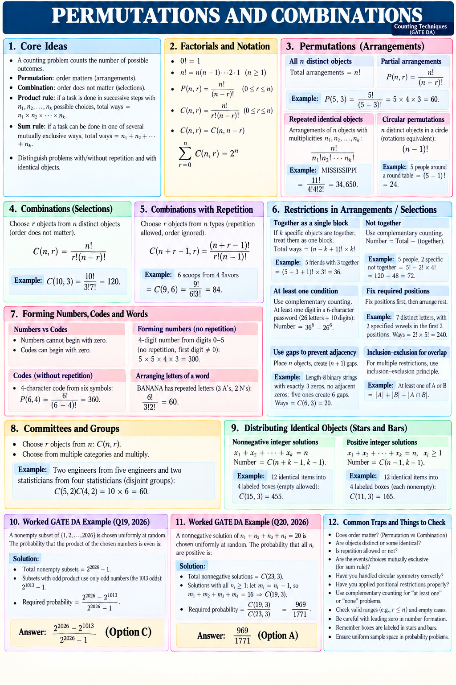

# Permutations and combinations — compact revision sheet

This is the primary revision page. It follows the user's supplied twelve-panel reference layout, with corrected restriction examples. The longer lessons remain available for extra explanation.

## 1. Core ideas

- Counting finds the number of possible outcomes.
- Permutation: order matters. Combination: order does not matter.
- Product rule: multiply successive choice counts n₁×n₂×···×nₖ when each partial choice has the stated number of continuations.
- Sum rule: add counts of mutually exclusive cases.
- Distinguish repetition of choices from identical objects.

## 2. Factorials and notation

0!=1; n!=n(n−1)···2·1 for n≥1.
P(n,r)=n!/(n−r)! and C(n,r)=n!/[r!(n−r)!], for integers 0≤r≤n.
C(n,r)=C(n,n−r); Σ from r=0 to n of C(n,r)=2^n.

## 3. Permutations

All n distinct objects: n!. Ordered r selections: P(n,r).
Example: P(5,3)=5×4×3=60.
Identical multiplicities n₁+···+nₖ=n: n!/(n₁!···nₖ!).
MISSISSIPPI: 11!/(4!4!2!)=34,650.
n distinct objects around an unnumbered circle, rotations equivalent: (n−1)!.
Five people around a round table: 4!=24. Reflections are distinct unless specified otherwise.

## 4. Combinations

Choose r of n distinct objects without order: C(n,r)=n!/[r!(n−r)!].
Example: C(10,3)=120.

## 5. Combinations with repetition

Choose r objects from n types, unlimited repetition and order ignored: C(n+r−1,r), n≥1.
Six scoops from four flavors: C(9,6)=84.

## 6. Restrictions

- k specified objects together among n distinct objects: (n−k+1)!k!. Five friends, three specified together: 3!3!=36.
- Two specified people not adjacent among five people: 5!−2!4!=120−48=72.
- At least one digit in a six-character password using 26 letters and 10 digits: 36^6−26^6.
- Seven distinct letters, including two specified vowels that must occupy the first two positions: 2!5!=240.
- Length-8 binary strings with exactly three zeros, no adjacent zeros: place five ones to form six gaps; choose three gaps. C(6,3)=20.
- Overlapping conditions: |A∪B|=|A|+|B|−|A∩B|.

## 7. Numbers, codes and words

Numbers cannot begin with zero; codes can.
Four-digit numbers from digits 0–5 without repetition: 5×5×4×3=300.
Length-4 codes from six symbols without repetition: P(6,4)=360.
BANANA: six letters, A repeated three times and N twice. 6!/(3!2!)=60.

## 8. Committees

Choose from multiple categories and multiply.
Two engineers from five and two statisticians from four, with disjoint groups: C(5,2)C(4,2)=10×6=60.

## 9. Stars and bars

n identical objects into k labeled boxes; n≥0, k≥1.
Nonnegative integer solutions x₁+···+xₖ=n, xᵢ≥0: C(n+k−1,k−1).
12 objects into 4 boxes, empty allowed: C(15,3)=455.
Positive solutions xᵢ≥1: C(n−1,k−1) for n≥k; otherwise zero.
12 objects into 4 nonempty boxes: C(11,3)=165.

## 10. GATE DA 2026 Q19 — worked paraphrase

Under uniform sampling of nonempty subsets of {1,…,2026}, find the probability of an even product.
Total: 2^2026−1. Odd-only subsets use the 1,013 odd elements: 2^1013−1.
Answer: (2^2026−2^1013)/(2^2026−1). Official key: C.

## 11. GATE DA 2026 Q20 — worked paraphrase

Under uniform sampling of nonnegative integer solutions n₁+n₂+n₃+n₄=20, find the probability all four are positive.
Total solutions: C(23,3).
For all nᵢ≥1, put mᵢ=nᵢ−1; the new sum is 16. Favorable: C(19,3).
Answer: C(19,3)/C(23,3)=969/1771. Official key: A.

## 12. Traps to check

Order; distinct versus identical objects; repetition; disjoint cases; rotations versus reflections; positional restrictions; complement counting; valid ranges; empty cases; leading zero; labeled boxes; uniform probability models.

## Source and style record

The user-supplied image sets the visual style. The two PYQ results were checked against the official DA 2026 final key in the previous source review; see [Sources and checks](Sources_and_Checks.md). The original stems say random; uniform sampling is the interpretation underlying these count-ratio answers.

Corrections to the supplied reference: the positional-restriction example uses 2!5!, the gap example uses a precisely specified binary-string model, and the password example is described as six characters.

Produced with built-in ImageGen. [Prompt](Compact_Overview_Prompt.md).

