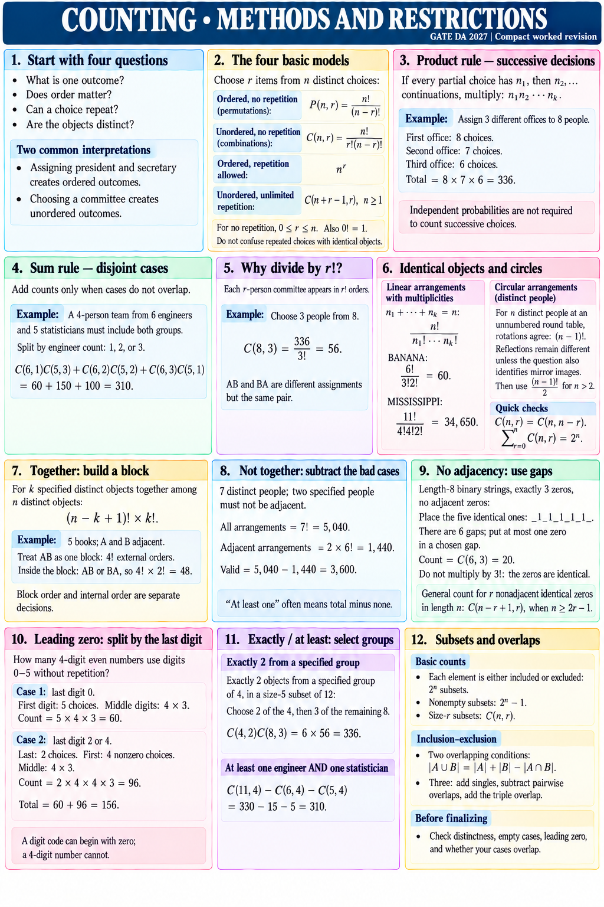

# COUNTING • METHODS AND RESTRICTIONS

GATE DA 2027 | Compact worked revision

## Start with four questions
What is one outcome? Does order matter? Can a choice repeat? Are the objects distinct?
Assigning president and secretary creates ordered outcomes. Choosing a committee creates unordered outcomes.

## The four basic models
Choose r items from n distinct choices:
• Ordered, no repetition: P(n,r) = n!/(n−r)!.
• Unordered, no repetition: C(n,r) = n!/[r!(n−r)!].
• Ordered, repetition allowed: n^r.
• Unordered, unlimited repetition: C(n+r−1,r), n≥1.
For no repetition, 0≤r≤n. Also 0!=1.
Do not confuse repeated choices with identical objects.

## Product rule — successive decisions
If every partial choice has n₁, then n₂, … continuations, multiply: n₁n₂···nₖ.
Example: assign 3 different offices to 8 people.
First office: 8 choices. Second: 7. Third: 6.
Total = 8×7×6 = 336.
Independent probabilities are not required to count successive choices.

## Sum rule — disjoint cases
Add counts only when cases do not overlap.
Example: a 4-person team from 6 engineers and 5 statisticians must include both groups.
Split by engineer count: 1, 2, or 3.
C(6,1)C(5,3)+C(6,2)C(5,2)+C(6,3)C(5,1)
= 60+150+100 = 310.

## Why divide by r!?
Each r-person committee appears in r! orders.
Choose 3 people from 8: C(8,3)=336/3!=56.
AB and BA are different assignments but the same pair.

## Identical objects and circles
Linear arrangements with multiplicities n₁+···+nₖ=n:
n!/(n₁!···nₖ!).
BANANA: 6!/(3!2!)=60.
MISSISSIPPI: 11!/(4!4!2!)=34,650.
For n distinct people at an unnumbered round table, rotations agree: (n−1)!.
Reflections remain different unless the question also identifies mirror images. Then use (n−1)!/2 for n>2.
Quick checks: C(n,r)=C(n,n−r); Σ from r=0 to n of C(n,r)=2^n.

## Together: build a block
For k specified distinct objects together among n distinct objects:
(n−k+1)! × k!.
Example: 5 books; A and B adjacent.
Treat AB as one block: 4! external orders.
Inside the block: AB or BA, so 4!×2!=48.
Block order and internal order are separate decisions.

## Not together: subtract the bad cases
7 distinct people; two specified people must not be adjacent.
All arrangements = 7!=5,040.
Adjacent arrangements = 2×6!=1,440.
Valid = 5,040−1,440=3,600.
“At least one” often means total minus none.

## No adjacency: use gaps
Length-8 binary strings, exactly 3 zeros, no adjacent zeros:
Place the five identical ones: _1_1_1_1_1_.
There are 6 gaps; put at most one zero in a chosen gap.
Count = C(6,3)=20.
Do not multiply by 3!: the zeros are identical.
General count for r nonadjacent identical zeros in length n: C(n−r+1,r), when n≥2r−1.

## Leading zero: split by the last digit
How many 4-digit even numbers use digits 0–5 without repetition?
Case 1: last digit 0. First digit: 5 choices. Middle digits: 4×3.
Count = 5×4×3=60.
Case 2: last digit 2 or 4. Last: 2 choices. First: 4 nonzero choices. Middle: 4×3.
Count = 2×4×4×3=96.
Total = 60+96=156.
A digit code can begin with zero; a 4-digit number cannot.

## Exactly / at least: select groups
Exactly 2 objects from a specified group of 4, in a size-5 subset of 12:
Choose 2 of the 4, then 3 of the remaining 8.
C(4,2)C(8,3)=6×56=336.
At least one engineer AND one statistician:
C(11,4)−C(6,4)−C(5,4)=330−15−5=310.

## Subsets and overlaps
Each element is either included or excluded: 2^n subsets.
Nonempty subsets: 2^n−1. Size-r subsets: C(n,r).
Two overlapping conditions: |A∪B|=|A|+|B|−|A∩B|.
Three: add singles, subtract pairwise overlaps, add the triple overlap.
Before finalizing: check distinctness, empty cases, leading zero, and whether your cases overlap.
