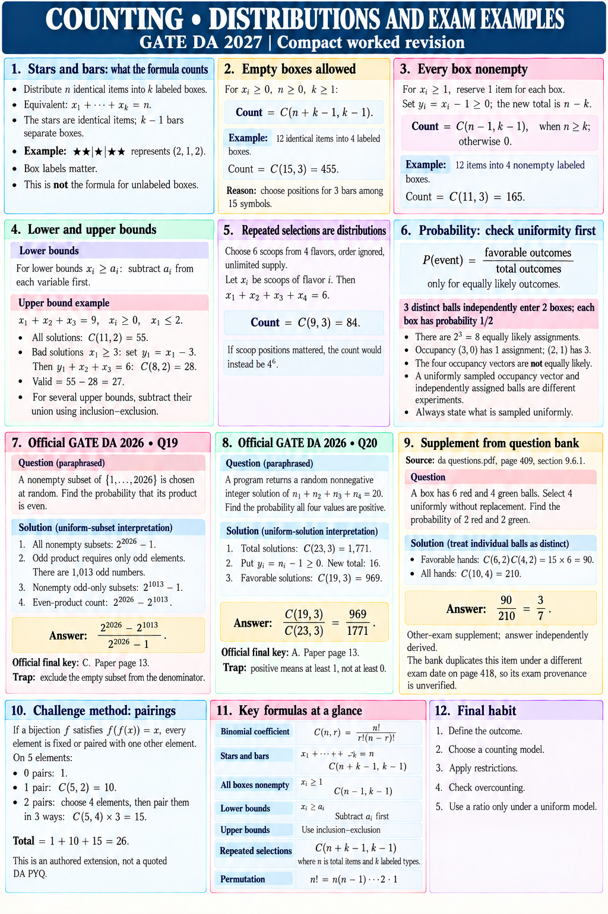

# COUNTING • DISTRIBUTIONS AND EXAM EXAMPLES

GATE DA 2027 | Compact worked revision

## Stars and bars: what the formula counts
Distribute n identical items into k labeled boxes.
Equivalent: x₁+···+xₖ=n.
The stars are identical items; k−1 bars separate boxes.
Example: ★★|★|★★ represents (2,1,2).
Box labels matter. This is not the formula for unlabeled boxes.

## Empty boxes allowed
For xᵢ≥0, n≥0, k≥1:
Count = C(n+k−1,k−1).
12 identical items into 4 labeled boxes:
C(15,3)=455.
Reason: choose positions for 3 bars among 15 symbols.

## Every box nonempty
For xᵢ≥1, reserve 1 item for each box.
Set yᵢ=xᵢ−1≥0; the new total is n−k.
Count = C(n−1,k−1), when n≥k; otherwise 0.
12 items into 4 nonempty labeled boxes:
C(11,3)=165.

## Lower and upper bounds
Lower bounds xᵢ≥aᵢ: subtract aᵢ from each variable first.
Upper bound example: x₁+x₂+x₃=9, xᵢ≥0, x₁≤2.
All solutions: C(11,2)=55.
Bad solutions x₁≥3: set y₁=x₁−3.
Then y₁+x₂+x₃=6: C(8,2)=28.
Valid = 55−28=27.
For several upper bounds, subtract their union using inclusion–exclusion.

## Repeated selections are distributions
Choose 6 scoops from 4 flavors, order ignored, unlimited supply.
Let xᵢ be scoops of flavor i. Then x₁+x₂+x₃+x₄=6.
Count = C(9,3)=84.
If scoop positions mattered, the count would instead be 4^6.

## Probability: check uniformity first
P(event)=favorable outcomes / total outcomes only for equally likely outcomes.
3 distinct balls independently enter 2 boxes, each with probability 1/2.
There are 2^3=8 equally likely assignments.
Occupancy (3,0) has 1 assignment; (2,1) has 3.
The four occupancy vectors are not equally likely.
A uniformly sampled occupancy vector and independently assigned balls are different experiments.
Always state what is sampled uniformly.

## Official GATE DA 2026 • Q19
Question, paraphrased: A nonempty subset of {1,…,2026} is chosen at random. Find the probability that its product is even.
Use the uniform-subset interpretation underlying the key.
1. All nonempty subsets: 2^2026−1.
2. Odd product requires only odd elements. There are 1,013 odd numbers.
3. Nonempty odd-only subsets: 2^1013−1.
4. Even-product count: 2^2026−2^1013.
Answer: (2^2026−2^1013)/(2^2026−1).
Official final key: C. Paper page 13.
Trap: exclude the empty subset from the denominator.

## Official GATE DA 2026 • Q20
Question, paraphrased: A program returns a random nonnegative integer solution of n₁+n₂+n₃+n₄=20. Find the probability all four values are positive.
Use the uniform-solution interpretation underlying the key.
1. Total solutions: C(23,3)=1,771.
2. Put yᵢ=nᵢ−1≥0. New total: 16.
3. Favorable solutions: C(19,3)=969.
Answer: C(19,3)/C(23,3)=969/1771.
Official final key: A. Paper page 13.
Trap: positive means at least 1, not at least 0.

## Supplement from the supplied question bank
Source: da questions.pdf, page 409, section 9.6.1.
Question: A box has 6 red and 4 green balls. Select 4 uniformly without replacement. Find the probability of 2 red and 2 green.
Treat individual balls as distinct.
Favorable hands: C(6,2)C(4,2)=15×6=90.
All hands: C(10,4)=210.
Answer: 90/210=3/7.
Other-exam supplement; answer independently derived.
The bank duplicates this item under a different exam date on page 418, so its exam provenance is unverified.

## Challenge method: pairings
If a bijection f satisfies f(f(x))=x, every element is fixed or paired with one other element.
On 5 elements:
0 pairs: 1.
1 pair: C(5,2)=10.
2 pairs: choose 4 elements, then pair them in 3 ways: C(5,4)×3=15.
Total = 1+10+15=26.
This is an authored extension, not a quoted DA PYQ.

## Final habit
Define the outcome → choose a counting model → apply restrictions → check overcounting → use a ratio only under a uniform model.
