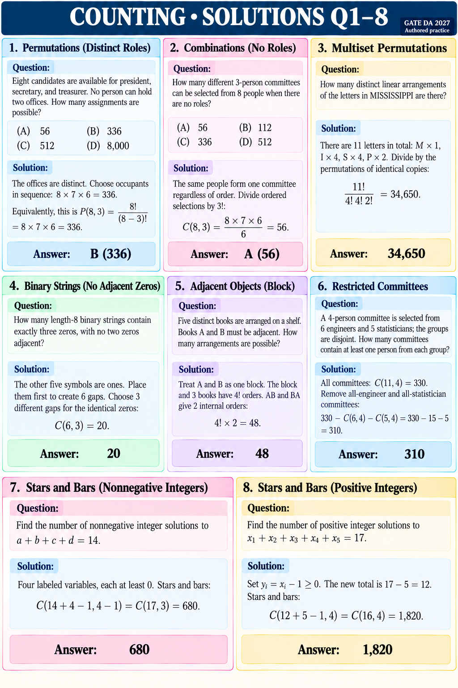

# COUNTING • SOLUTIONS Q1–8

GATE DA 2027 | Authored practice. Every question is repeated with its explanation and answer.

## Q1 • MCQ
Question: Eight candidates are available for president, secretary, and treasurer. No person can hold two offices. How many assignments are possible?
(A) 56  (B) 336  (C) 512  (D) 8,000

Solution: The offices are distinct. Choose occupants in sequence: 8×7×6=336. Equivalently P(8,3).
Answer: B (336).

## Q2 • MCQ
Question: How many different 3-person committees can be selected from 8 people when there are no roles?
(A) 56  (B) 112  (C) 336  (D) 512

Solution: The same people form one committee regardless of order. Divide ordered selections by 3!: C(8,3)=(8×7×6)/6=56.
Answer: A (56).

## Q3 • NAT
Question: How many distinct linear arrangements of the letters in MISSISSIPPI are there?

Solution: 11 letters: M×1, I×4, S×4, P×2. Divide by permutations of identical copies: 11!/(4!4!2!)=34,650.
Answer: 34,650.

## Q4 • NAT
Question: How many length-8 binary strings contain exactly three zeros, with no two zeros adjacent?

Solution: The other five symbols are ones. Place them first to create 6 gaps. Choose 3 different gaps for the identical zeros: C(6,3)=20.
Answer: 20.

## Q5 • NAT
Question: Five distinct books are arranged on a shelf. Books A and B must be adjacent. How many arrangements are possible?

Solution: Treat A and B as one block. The block and 3 books have 4! orders. AB and BA give 2 internal orders: 4!×2=48.
Answer: 48.

## Q6 • NAT
Question: A 4-person committee is selected from 6 engineers and 5 statisticians; the groups are disjoint. How many committees contain at least one person from each group?

Solution: All committees: C(11,4)=330. Remove all-engineer and all-statistician committees: 330−C(6,4)−C(5,4)=330−15−5=310.
Answer: 310.

## Q7 • NAT
Question: Find the number of nonnegative integer solutions to a+b+c+d=14.

Solution: Four labeled variables, each at least 0. Stars and bars: C(14+4−1,4−1)=C(17,3)=680.
Answer: 680.

## Q8 • NAT
Question: Find the number of positive integer solutions to x₁+x₂+x₃+x₄+x₅=17.

Solution: Set yᵢ=xᵢ−1≥0. The new total is 17−5=12. Stars and bars: C(12+5−1,4)=C(16,4)=1,820.
Answer: 1,820.
