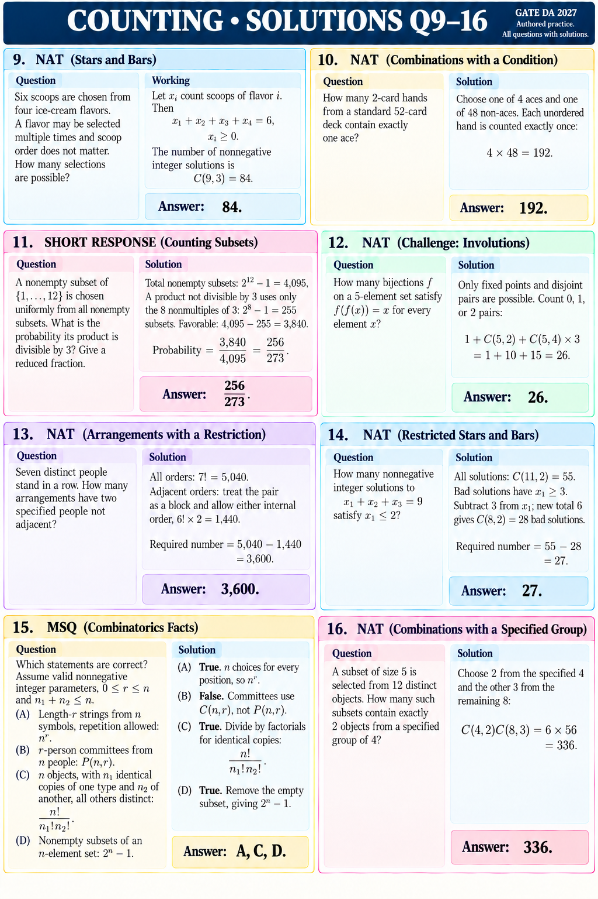

# COUNTING • SOLUTIONS Q9–16

GATE DA 2027 | Authored practice. Every question is repeated with its explanation and answer.

## Q9 • NAT
Question: Six scoops are chosen from four ice-cream flavors. A flavor may be selected multiple times and scoop order does not matter. How many selections are possible?

Solution: Let xᵢ count scoops of flavor i. Then x₁+x₂+x₃+x₄=6, xᵢ≥0. Count C(9,3)=84.
Answer: 84.

## Q10 • NAT
Question: How many 2-card hands from a standard 52-card deck contain exactly one ace?

Solution: Choose one of 4 aces and one of 48 non-aces. Each unordered hand is counted exactly once: 4×48=192.
Answer: 192.

## Q11 • SHORT RESPONSE
Question: A nonempty subset of {1,…,12} is chosen uniformly from all nonempty subsets. What is the probability its product is divisible by 3? Give a reduced fraction.

Solution: Total nonempty subsets: 2^12−1=4,095. A product not divisible by 3 uses only the 8 nonmultiples of 3: 2^8−1=255 subsets. Favorable: 4,095−255=3,840.
Answer: 3,840/4,095=256/273.

## Q12 • NAT • CHALLENGE
Question: How many bijections f on a 5-element set satisfy f(f(x))=x for every element x?

Solution: Only fixed points and disjoint pairs are possible. Count 0, 1, or 2 pairs: 1+C(5,2)+C(5,4)×3=1+10+15=26.
Answer: 26.

## Q13 • NAT
Question: Seven distinct people stand in a row. How many arrangements have two specified people not adjacent?

Solution: All orders: 7!=5,040. Adjacent orders: treat the pair as a block and allow either internal order, 6!×2=1,440. Subtract.
Answer: 5,040−1,440=3,600.

## Q14 • NAT
Question: How many nonnegative integer solutions to x₁+x₂+x₃=9 satisfy x₁≤2?

Solution: All solutions: C(11,2)=55. Bad solutions have x₁≥3. Subtract 3 from x₁; new total 6 gives C(8,2)=28 bad solutions.
Answer: 55−28=27.

## Q15 • MSQ
Question: Which statements are correct? Assume valid nonnegative integer parameters, 0≤r≤n and n₁+n₂≤n.
(A) Length-r strings from n symbols, repetition allowed: n^r.
(B) r-person committees from n people: P(n,r).
(C) n objects, with n₁ identical copies of one type and n₂ of another, all others distinct: n!/(n₁!n₂!).
(D) Nonempty subsets of an n-element set: 2^n−1.

Solution: A: true, n choices for every position. B: false, committees use C(n,r). C: true, divide out identical copies. D: true, remove the empty subset.
Answer: A, C, D.

## Q16 • NAT
Question: A subset of size 5 is selected from 12 distinct objects. How many such subsets contain exactly 2 objects from a specified group of 4?

Solution: Choose 2 from the specified 4 and the other 3 from the remaining 8: C(4,2)C(8,3)=6×56=336.
Answer: 336.
