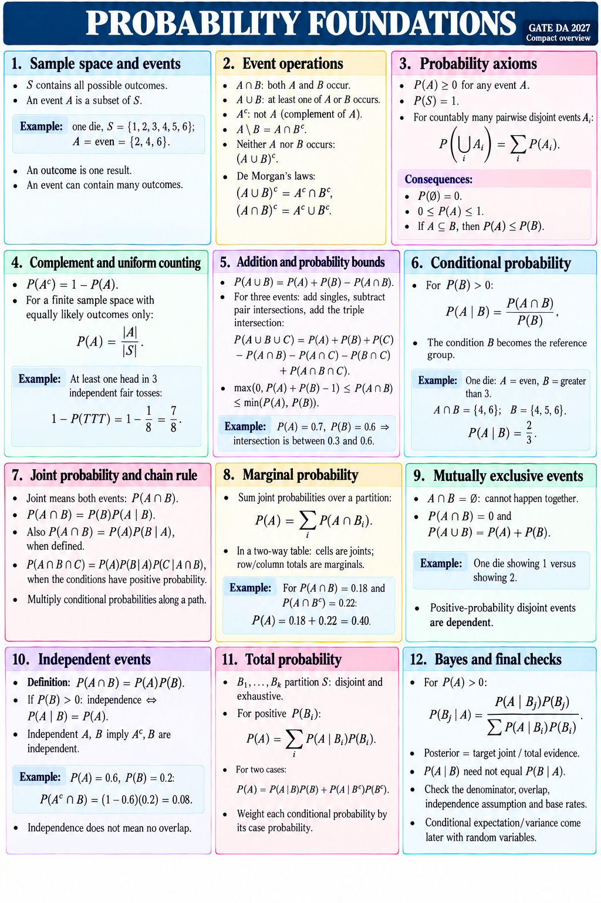

# PROBABILITY FOUNDATIONS
GATE DA 2027 | Compact overview

## 1. Sample space and events
S contains all possible outcomes. An event A is a subset of S.
Example: one die, S={1,2,3,4,5,6}; A=even={2,4,6}.
An outcome is one result; an event can contain many outcomes.

## 2. Event operations
A∩B: both. A∪B: at least one. Aᶜ: not A.
A\B = A∩Bᶜ.
Neither A nor B = (A∪B)ᶜ.
De Morgan: (A∪B)ᶜ=Aᶜ∩Bᶜ; (A∩B)ᶜ=Aᶜ∪Bᶜ.

## 3. Probability axioms
P(A)≥0; P(S)=1.
For countably many pairwise disjoint events Aᵢ:
P(⋃ᵢ Aᵢ)=ΣᵢP(Aᵢ).
Consequences: P(∅)=0; 0≤P(A)≤1.
If A⊆B, then P(A)≤P(B).

## 4. Complement and uniform counting
P(Aᶜ)=1−P(A).
For a finite sample space with equally likely outcomes only:
P(A)=|A|/|S|.
At least one head in 3 independent fair tosses:
1−P(TTT)=1−1/8=7/8.

## 5. Addition and probability bounds
P(A∪B)=P(A)+P(B)−P(A∩B).
For three events: add singles, subtract pair intersections, add the triple intersection.
max(0,P(A)+P(B)−1)≤P(A∩B)≤min(P(A),P(B)).
Example: P(A)=0.7, P(B)=0.6 ⇒ intersection is between 0.3 and 0.6.

## 6. Conditional probability
For P(B)>0:
P(A|B)=P(A∩B)/P(B).
The condition B becomes the reference group.
Die: A=even, B=greater than 3.
A∩B={4,6}; B={4,5,6}.
P(A|B)=2/3.

## 7. Joint probability and chain rule
Joint means both events: P(A∩B).
P(A∩B)=P(B)P(A|B).
Also P(A∩B)=P(A)P(B|A), when defined.
P(A∩B∩C)=P(A)P(B|A)P(C|A∩B), when the conditions have positive probability.
Multiply conditional probabilities along a path.

## 8. Marginal probability
Sum joint probabilities over a partition:
P(A)=ΣᵢP(A∩Bᵢ).
In a two-way table: cells are joints; row/column totals are marginals.
For P(A∩B)=0.18 and P(A∩Bᶜ)=0.22:
P(A)=0.18+0.22=0.40.

## 9. Mutually exclusive events
A∩B=∅: cannot happen together.
P(A∩B)=0 and P(A∪B)=P(A)+P(B).
Example: one die showing 1 versus showing 2.
Positive-probability disjoint events are dependent.

## 10. Independent events
Definition: P(A∩B)=P(A)P(B).
If P(B)>0: independence ⇔ P(A|B)=P(A).
Independent A,B imply Aᶜ,B are independent.
Example: P(A)=0.6, P(B)=0.2:
P(Aᶜ∩B)=(1−0.6)(0.2)=0.08.
Independence does not mean no overlap.

## 11. Total probability
B₁,…,Bₖ partition S: disjoint and exhaustive.
For positive P(Bᵢ):
P(A)=ΣᵢP(A|Bᵢ)P(Bᵢ).
For two cases: P(A)=P(A|B)P(B)+P(A|Bᶜ)P(Bᶜ).
Weight each conditional probability by its case probability.

## 12. Bayes and final checks
For P(A)>0:
P(Bⱼ|A)=P(A|Bⱼ)P(Bⱼ) / ΣᵢP(A|Bᵢ)P(Bᵢ).
Posterior = target joint / total evidence.
P(A|B) need not equal P(B|A).
Check the denominator, overlap, independence assumption and base rates.
Conditional expectation/variance come later with random variables.
