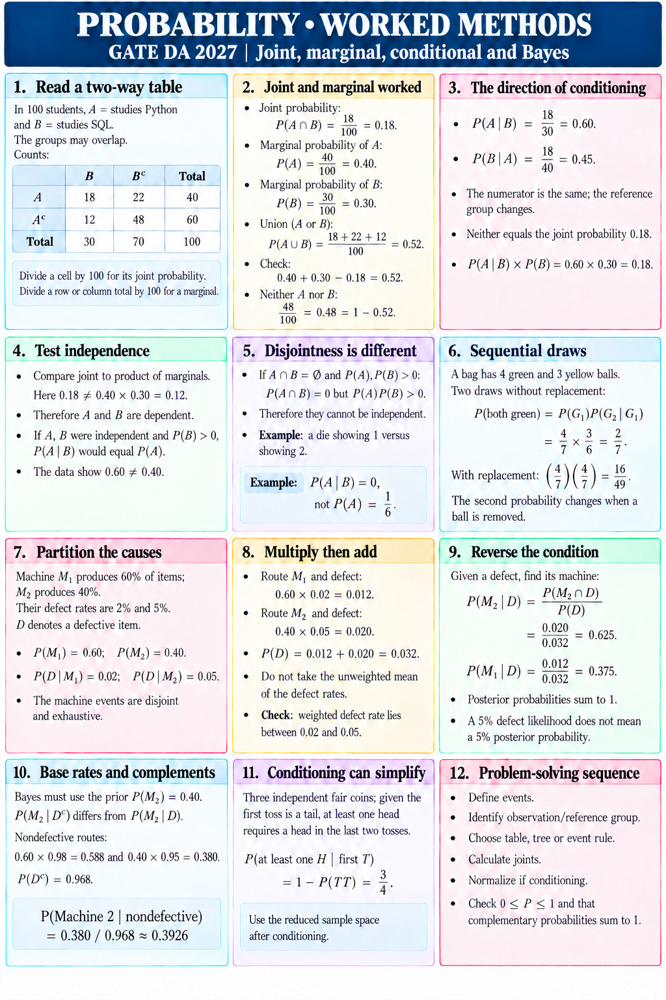

# PROBABILITY • WORKED METHODS
GATE DA 2027 | Joint, marginal, conditional and Bayes

## 1. Read a two-way table
In 100 students, A=studies Python and B=studies SQL.
The groups may overlap.
Counts:
             B      Bᶜ      Total
A           18      22       40
Aᶜ          12      48       60
Total       30      70      100
Divide a cell by 100 for its joint probability. Divide a row or column total by 100 for a marginal.

## 2. Joint and marginal worked
Joint: P(A∩B)=18/100=0.18.
Marginal: P(A)=40/100=0.40.
Marginal: P(B)=30/100=0.30.
Union: (18+22+12)/100=0.52.
Check: 0.40+0.30−0.18=0.52.
Neither: 48/100=0.48=1−0.52.

## 3. The direction of conditioning
P(A|B)=18/30=0.60.
P(B|A)=18/40=0.45.
The numerator is the same; the reference group changes.
Neither equals the joint probability 0.18.
P(A|B)×P(B)=0.60×0.30=0.18.

## 4. Test independence
Compare joint to product of marginals.
Here 0.18 ≠ 0.40×0.30=0.12.
Therefore A and B are dependent.
If A,B were independent and P(B)>0, P(A|B) would equal P(A).
The data show 0.60≠0.40.

## 5. Disjointness is different
If A∩B=∅ and P(A),P(B)>0:
P(A∩B)=0 but P(A)P(B)>0.
Therefore they cannot be independent.
Example: a die showing 1 versus showing 2.
P(A|B)=0, not P(A)=1/6.

## 6. Sequential draws
A bag has 4 green and 3 yellow balls.
Two draws without replacement:
P(both green)=P(G₁)P(G₂|G₁)
=(4/7)(3/6)=2/7.
With replacement: (4/7)(4/7)=16/49.
The second probability changes when a ball is removed.

## 7. Partition the causes
Machine M₁ produces 60% of items; M₂ produces 40%.
Their defect rates are 2% and 5%.
D denotes a defective item.
P(M₁)=0.60; P(M₂)=0.40.
P(D|M₁)=0.02; P(D|M₂)=0.05.
The machine events are disjoint and exhaustive.

## 8. Multiply then add
Route M₁ and defect: 0.60×0.02=0.012.
Route M₂ and defect: 0.40×0.05=0.020.
P(D)=0.012+0.020=0.032.
Do not take the unweighted mean of the defect rates.
Check: weighted defect rate lies between 0.02 and 0.05.

## 9. Reverse the condition
Given a defect, find its machine:
P(M₂|D)=P(M₂∩D)/P(D)
=0.020/0.032=0.625.
P(M₁|D)=0.012/0.032=0.375.
Posterior probabilities sum to 1.
A 5% defect likelihood does not mean a 5% posterior probability.

## 10. Base rates and complements
Bayes must use the prior P(M₂)=0.40.
P(M₂|Dᶜ) differs from P(M₂|D).
Nondefective routes: 0.60×0.98=0.588 and 0.40×0.95=0.380.
P(Dᶜ)=0.968.
P(M₂|Dᶜ)=0.380/0.968≈0.3926.

## 11. Conditioning can simplify
Three independent fair coins; given the first toss is a tail, at least one head requires a head in the last two tosses.
P(at least one H | first T)=1−P(TT)=3/4.
Use the reduced sample space after conditioning.

## 12. Problem-solving sequence
Define events → identify observation/reference group → choose table, tree or event rule → calculate joints → normalize if conditioning → check 0≤P≤1 and that complementary probabilities sum to 1.
