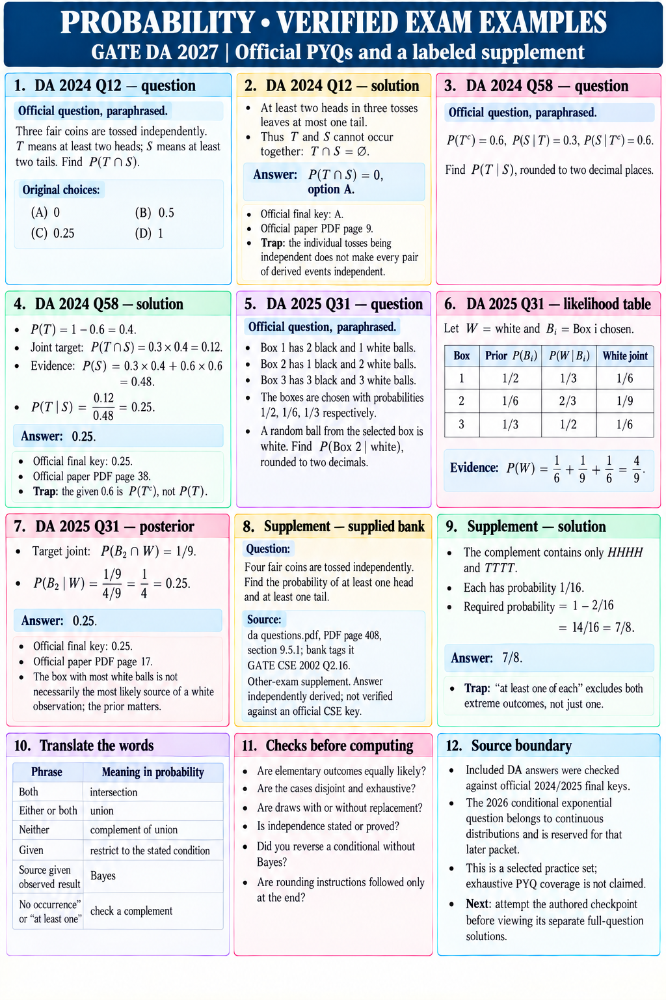

# PROBABILITY • VERIFIED EXAM EXAMPLES
GATE DA 2027 | Official PYQs and a labeled supplement

## 1. DA 2024 Q12 — question
Official question, paraphrased.
Three fair coins are tossed independently. T means at least two heads; S means at least two tails. Find P(T∩S).
Original choices: (A) 0; (B) 0.5; (C) 0.25; (D) 1.

## 2. DA 2024 Q12 — solution
At least two heads in three tosses leaves at most one tail.
Thus T and S cannot occur together: T∩S=∅.
Answer: P(T∩S)=0, option A.
Official final key: A. Official paper PDF page 9.
Trap: the individual tosses being independent does not make every pair of derived events independent.

## 3. DA 2024 Q58 — question
Official question, paraphrased.
P(Tᶜ)=0.6, P(S|T)=0.3, P(S|Tᶜ)=0.6.
Find P(T|S), rounded to two decimal places.

## 4. DA 2024 Q58 — solution
P(T)=1−0.6=0.4.
Joint target: P(T∩S)=0.3×0.4=0.12.
Evidence: P(S)=0.3×0.4+0.6×0.6=0.48.
P(T|S)=0.12/0.48=0.25.
Official final key: 0.25. Official paper PDF page 38.
Trap: the given 0.6 is P(Tᶜ), not P(T).

## 5. DA 2025 Q31 — question
Official question, paraphrased.
Box 1 has 2 black and 1 white balls.
Box 2 has 1 black and 2 white balls.
Box 3 has 3 black and 3 white balls.
The boxes are chosen with probabilities 1/2, 1/6, 1/3 respectively. A random ball from the selected box is white. Find P(Box 2 | white), rounded to two decimals.

## 6. DA 2025 Q31 — likelihood table
Let W=white and Bᵢ=Box i chosen.
Box | Prior P(Bᵢ) | P(W|Bᵢ) | White joint
1   | 1/2         | 1/3      | 1/6
2   | 1/6         | 2/3      | 1/9
3   | 1/3         | 1/2      | 1/6
Evidence P(W)=1/6+1/9+1/6=4/9.

## 7. DA 2025 Q31 — posterior
Target joint: P(B₂∩W)=1/9.
P(B₂|W)=(1/9)/(4/9)=1/4=0.25.
Official final key: 0.25. Official paper PDF page 17.
The box with most white balls is not necessarily the most likely source of a white observation; the prior matters.

## 8. Supplement — supplied bank
Question: Four fair coins are tossed independently. Find the probability of at least one head and at least one tail.
Source: da questions.pdf, PDF page 408, section 9.5.1; bank tags it GATE CSE 2002 Q2.16.
Other-exam supplement. Answer independently derived; not verified against an official CSE key.

## 9. Supplement — solution
The complement contains only HHHH and TTTT.
Each has probability 1/16.
Required probability=1−2/16=14/16=7/8.
Trap: “at least one of each” excludes both extreme outcomes, not just one.

## 10. Translate the words
“Both” → intersection.
“Either or both” → union.
“Neither” → complement of union.
“Given” → restrict to the stated condition.
“Source given observed result” → Bayes.
“No occurrence” or “at least one” → check a complement.

## 11. Checks before computing
Are elementary outcomes equally likely?
Are the cases disjoint and exhaustive?
Are draws with or without replacement?
Is independence stated or proved?
Did you reverse a conditional without Bayes?
Are rounding instructions followed only at the end?

## 12. Source boundary
Included DA answers were checked against official 2024/2025 final keys.
The 2026 conditional exponential question belongs to continuous distributions and is reserved for that later packet.
This is a selected practice set; exhaustive PYQ coverage is not claimed.
Next: attempt the authored checkpoint before viewing its separate full-question solutions.
