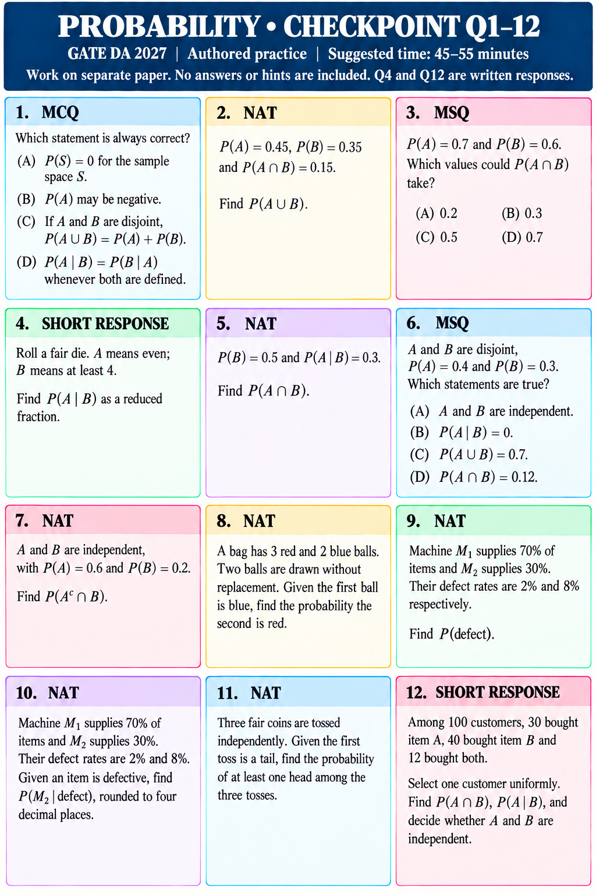

# PROBABILITY • CHECKPOINT Q1–12
GATE DA 2027 | Authored practice | Suggested time: 45–55 minutes
Work on separate paper. No answers or hints are included. Q4 and Q12 are written responses.

## Q1 • MCQ
Which statement is always correct?
(A) P(S)=0 for the sample space S.
(B) P(A) may be negative.
(C) If A and B are disjoint, P(A∪B)=P(A)+P(B).
(D) P(A|B)=P(B|A) whenever both are defined.

## Q2 • NAT
P(A)=0.45, P(B)=0.35 and P(A∩B)=0.15. Find P(A∪B).

## Q3 • MSQ
P(A)=0.7 and P(B)=0.6. Which values could P(A∩B) take?
(A) 0.2  (B) 0.3  (C) 0.5  (D) 0.7

## Q4 • SHORT RESPONSE
Roll a fair die. A means even; B means at least 4. Find P(A|B) as a reduced fraction.

## Q5 • NAT
P(B)=0.5 and P(A|B)=0.3. Find P(A∩B).

## Q6 • MSQ
A and B are disjoint, P(A)=0.4 and P(B)=0.3. Which statements are true?
(A) A and B are independent.
(B) P(A|B)=0.
(C) P(A∪B)=0.7.
(D) P(A∩B)=0.12.

## Q7 • NAT
A and B are independent, with P(A)=0.6 and P(B)=0.2. Find P(Aᶜ∩B).

## Q8 • NAT
A bag has 3 red and 2 blue balls. Two balls are drawn without replacement. Given the first ball is blue, find the probability the second is red.

## Q9 • NAT
Machine M₁ supplies 70% of items and M₂ supplies 30%. Their defect rates are 2% and 8% respectively. Find P(defect).

## Q10 • NAT
Machine M₁ supplies 70% of items and M₂ supplies 30%. Their defect rates are 2% and 8%. Given an item is defective, find P(M₂|defect), rounded to four decimal places.

## Q11 • NAT
Three fair coins are tossed independently. Given the first toss is a tail, find the probability of at least one head among the three tosses.

## Q12 • SHORT RESPONSE
Among 100 customers, 30 bought item A, 40 bought item B and 12 bought both. Select one customer uniformly. Find P(A∩B), P(A|B), and decide whether A and B are independent.
