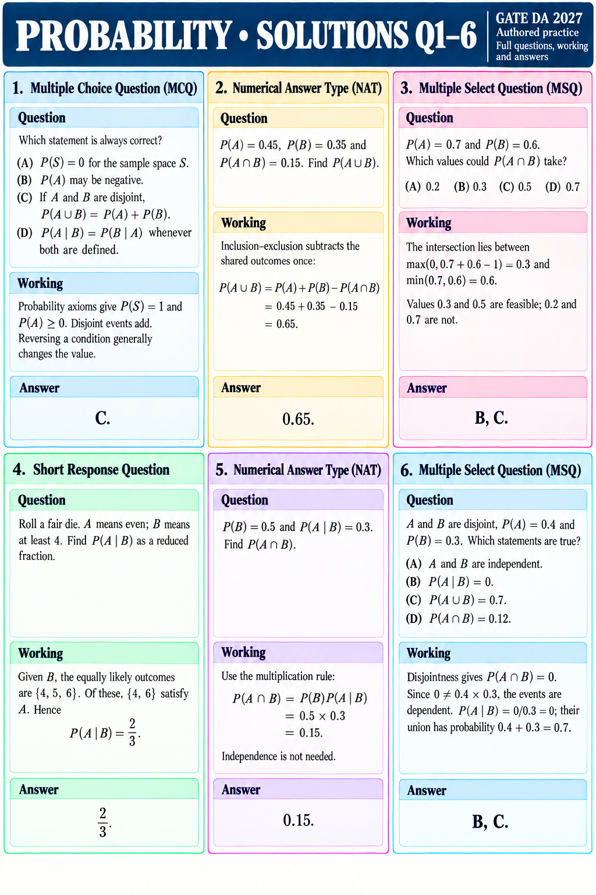

# PROBABILITY • SOLUTIONS Q1–6
GATE DA 2027 | Authored practice | Full questions, working and answers

## Q1 • MCQ
Question: Which statement is always correct?
(A) P(S)=0 for the sample space S.
(B) P(A) may be negative.
(C) If A and B are disjoint, P(A∪B)=P(A)+P(B).
(D) P(A|B)=P(B|A) whenever both are defined.

Working: Probability axioms give P(S)=1 and P(A)≥0. Disjoint events add. Reversing a condition generally changes the value.
Answer: C.

## Q2 • NAT
Question: P(A)=0.45, P(B)=0.35 and P(A∩B)=0.15. Find P(A∪B).

Working: Inclusion–exclusion subtracts the shared outcomes once: P(A∪B)=0.45+0.35−0.15=0.65.
Answer: 0.65.

## Q3 • MSQ
Question: P(A)=0.7 and P(B)=0.6. Which values could P(A∩B) take?
(A) 0.2  (B) 0.3  (C) 0.5  (D) 0.7

Working: The intersection lies between max(0,0.7+0.6−1)=0.3 and min(0.7,0.6)=0.6. Values 0.3 and 0.5 are feasible; 0.2 and 0.7 are not.
Answer: B, C.

## Q4 • SHORT RESPONSE
Question: Roll a fair die. A means even; B means at least 4. Find P(A|B) as a reduced fraction.

Working: Given B, the equally likely outcomes are {4,5,6}. Of these, {4,6} satisfy A. Hence P(A|B)=2/3.
Answer: 2/3.

## Q5 • NAT
Question: P(B)=0.5 and P(A|B)=0.3. Find P(A∩B).

Working: Use the multiplication rule: P(A∩B)=P(B)P(A|B)=0.5×0.3=0.15. Independence is not needed.
Answer: 0.15.

## Q6 • MSQ
Question: A and B are disjoint, P(A)=0.4 and P(B)=0.3. Which statements are true?
(A) A and B are independent.
(B) P(A|B)=0.
(C) P(A∪B)=0.7.
(D) P(A∩B)=0.12.

Working: Disjointness gives P(A∩B)=0. Since 0≠0.4×0.3, the events are dependent. P(A|B)=0/0.3=0; their union has probability 0.4+0.3=0.7.
Answer: B, C.
