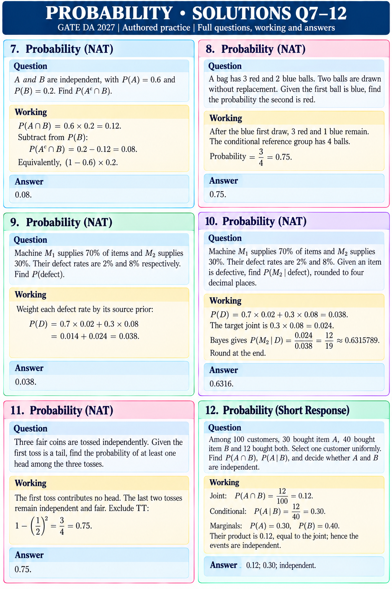

# PROBABILITY • SOLUTIONS Q7–12
GATE DA 2027 | Authored practice | Full questions, working and answers

## Q7 • NAT
Question: A and B are independent, with P(A)=0.6 and P(B)=0.2. Find P(Aᶜ∩B).

Working: P(A∩B)=0.6×0.2=0.12. Subtract from P(B): P(Aᶜ∩B)=0.2−0.12=0.08. Equivalently, (1−0.6)×0.2.
Answer: 0.08.

## Q8 • NAT
Question: A bag has 3 red and 2 blue balls. Two balls are drawn without replacement. Given the first ball is blue, find the probability the second is red.

Working: After the blue first draw, 3 red and 1 blue remain. The conditional reference group has 4 balls. Probability=3/4=0.75.
Answer: 0.75.

## Q9 • NAT
Question: Machine M₁ supplies 70% of items and M₂ supplies 30%. Their defect rates are 2% and 8% respectively. Find P(defect).

Working: Weight each defect rate by its source prior: P(D)=0.7×0.02+0.3×0.08=0.014+0.024=0.038.
Answer: 0.038.

## Q10 • NAT
Question: Machine M₁ supplies 70% of items and M₂ supplies 30%. Their defect rates are 2% and 8%. Given an item is defective, find P(M₂|defect), rounded to four decimal places.

Working: P(D)=0.7×0.02+0.3×0.08=0.038. The target joint is 0.3×0.08=0.024. Bayes gives 0.024/0.038=12/19≈0.6315789. Round at the end.
Answer: 0.6316.

## Q11 • NAT
Question: Three fair coins are tossed independently. Given the first toss is a tail, find the probability of at least one head among the three tosses.

Working: The first toss contributes no head. The last two tosses remain independent and fair. Exclude TT: 1−(1/2)²=3/4=0.75.
Answer: 0.75.

## Q12 • SHORT RESPONSE
Question: Among 100 customers, 30 bought item A, 40 bought item B and 12 bought both. Select one customer uniformly. Find P(A∩B), P(A|B), and decide whether A and B are independent.

Working: Joint: 12/100=0.12. Conditional: 12/40=0.30. Marginals: P(A)=0.30, P(B)=0.40. Their product is 0.12, equal to the joint; hence the events are independent.
Answer: 0.12; 0.30; independent.
