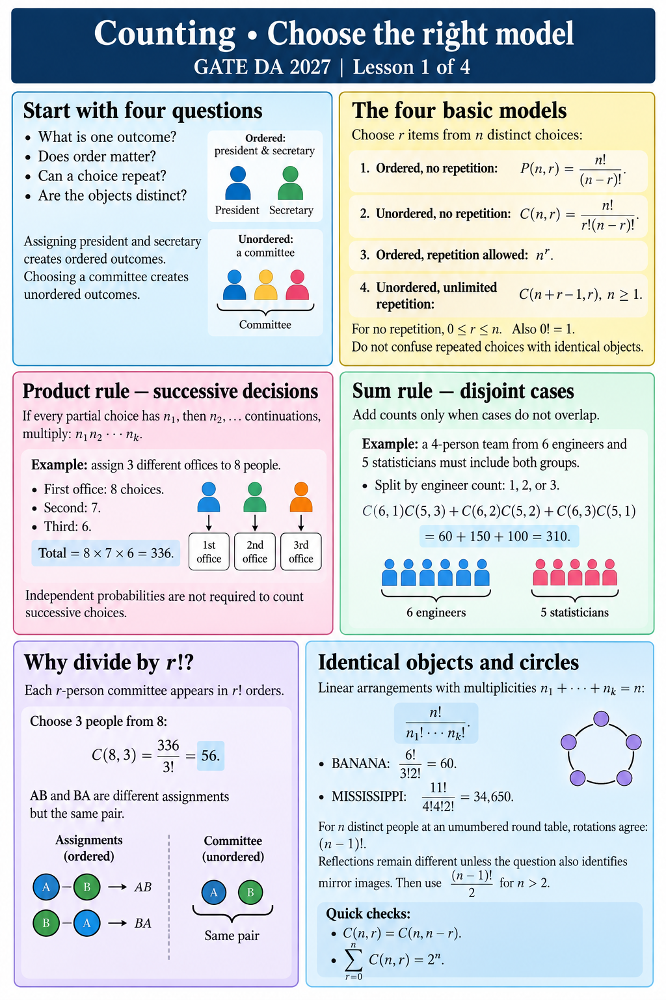

# Counting • Choose the right model
GATE DA 2027 | Lesson 1 of 4

## Start with four questions
What is one outcome? Does order matter? Can a choice repeat? Are the objects distinct?
Assigning president and secretary creates ordered outcomes. Choosing a committee creates unordered outcomes.

## The four basic models
Choose r items from n distinct choices:
• Ordered, no repetition: P(n,r) = n!/(n−r)!.
• Unordered, no repetition: C(n,r) = n!/[r!(n−r)!].
• Ordered, repetition allowed: n^r.
• Unordered, unlimited repetition: C(n+r−1,r), n≥1.
For no repetition, 0≤r≤n. Also 0!=1.
Do not confuse repeated choices with identical objects.

## Product rule — successive decisions
If every partial choice has n₁, then n₂, … continuations, multiply: n₁n₂···nₖ.
Example: assign 3 different offices to 8 people.
First office: 8 choices. Second: 7. Third: 6.
Total = 8×7×6 = 336.
Independent probabilities are not required to count successive choices.

## Sum rule — disjoint cases
Add counts only when cases do not overlap.
Example: a 4-person team from 6 engineers and 5 statisticians must include both groups.
Split by engineer count: 1, 2, or 3.
C(6,1)C(5,3)+C(6,2)C(5,2)+C(6,3)C(5,1)
= 60+150+100 = 310.

## Why divide by r!?
Each r-person committee appears in r! orders.
Choose 3 people from 8: C(8,3)=336/3!=56.
AB and BA are different assignments but the same pair.

## Identical objects and circles
Linear arrangements with multiplicities n₁+···+nₖ=n:
n!/(n₁!···nₖ!).
BANANA: 6!/(3!2!)=60.
MISSISSIPPI: 11!/(4!4!2!)=34,650.
For n distinct people at an unnumbered round table, rotations agree: (n−1)!.
Reflections remain different unless the question also identifies mirror images. Then use (n−1)!/2 for n>2.
Quick checks: C(n,r)=C(n,n−r); Σ from r=0 to n of C(n,r)=2^n.
