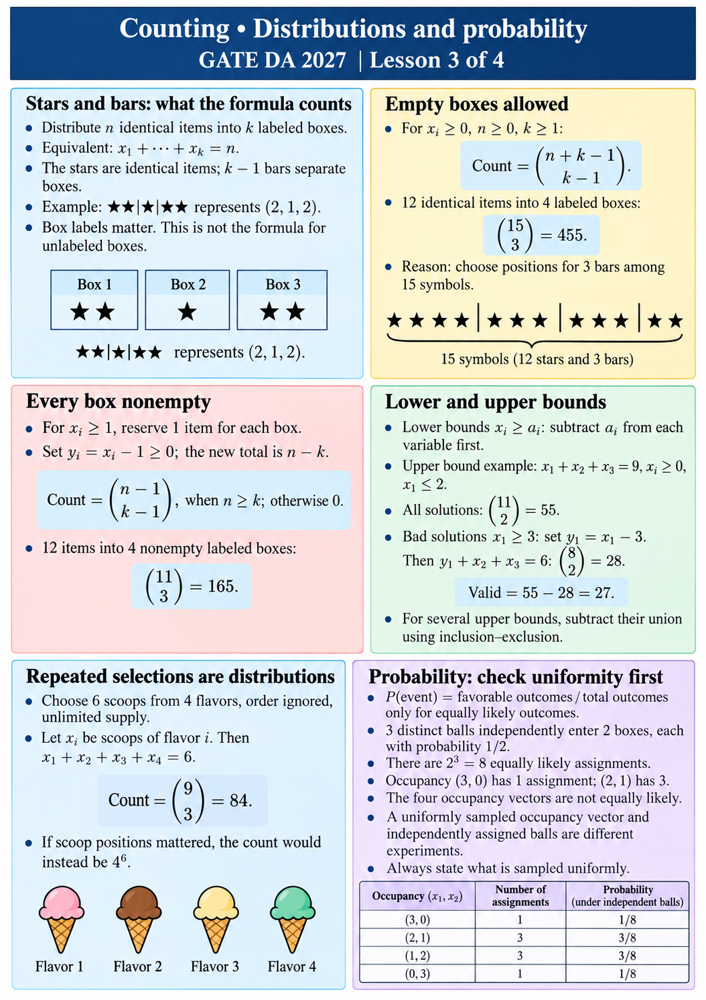

# Counting • Distributions and probability
GATE DA 2027 | Lesson 3 of 4

## Stars and bars: what the formula counts
Distribute n identical items into k labeled boxes.
Equivalent: x₁+···+xₖ=n.
The stars are identical items; k−1 bars separate boxes.
Example: ★★|★|★★ represents (2,1,2).
Box labels matter. This is not the formula for unlabeled boxes.

## Empty boxes allowed
For xᵢ≥0, n≥0, k≥1:
Count = C(n+k−1,k−1).
12 identical items into 4 labeled boxes:
C(15,3)=455.
Reason: choose positions for 3 bars among 15 symbols.

## Every box nonempty
For xᵢ≥1, reserve 1 item for each box.
Set yᵢ=xᵢ−1≥0; the new total is n−k.
Count = C(n−1,k−1), when n≥k; otherwise 0.
12 items into 4 nonempty labeled boxes:
C(11,3)=165.

## Lower and upper bounds
Lower bounds xᵢ≥aᵢ: subtract aᵢ from each variable first.
Upper bound example: x₁+x₂+x₃=9, xᵢ≥0, x₁≤2.
All solutions: C(11,2)=55.
Bad solutions x₁≥3: set y₁=x₁−3.
Then y₁+x₂+x₃=6: C(8,2)=28.
Valid = 55−28=27.
For several upper bounds, subtract their union using inclusion–exclusion.

## Repeated selections are distributions
Choose 6 scoops from 4 flavors, order ignored, unlimited supply.
Let xᵢ be scoops of flavor i. Then x₁+x₂+x₃+x₄=6.
Count = C(9,3)=84.
If scoop positions mattered, the count would instead be 4^6.

## Probability: check uniformity first
P(event)=favorable outcomes / total outcomes only for equally likely outcomes.
3 distinct balls independently enter 2 boxes, each with probability 1/2.
There are 2^3=8 equally likely assignments.
Occupancy (3,0) has 1 assignment; (2,1) has 3.
The four occupancy vectors are not equally likely.
A uniformly sampled occupancy vector and independently assigned balls are different experiments.
Always state what is sampled uniformly.
