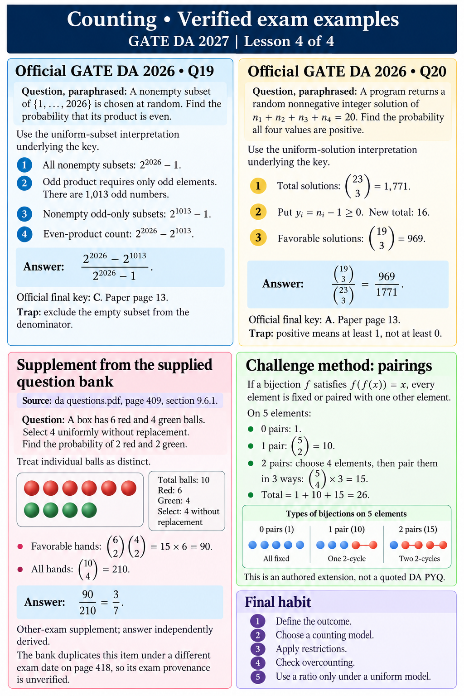

# Counting • Verified exam examples
GATE DA 2027 | Lesson 4 of 4

## Official GATE DA 2026 • Q19
Question, paraphrased: A nonempty subset of {1,…,2026} is chosen at random. Find the probability that its product is even.
Use the uniform-subset interpretation underlying the key.
1. All nonempty subsets: 2^2026−1.
2. Odd product requires only odd elements. There are 1,013 odd numbers.
3. Nonempty odd-only subsets: 2^1013−1.
4. Even-product count: 2^2026−2^1013.
Answer: (2^2026−2^1013)/(2^2026−1).
Official final key: C. Paper page 13.
Trap: exclude the empty subset from the denominator.

## Official GATE DA 2026 • Q20
Question, paraphrased: A program returns a random nonnegative integer solution of n₁+n₂+n₃+n₄=20. Find the probability all four values are positive.
Use the uniform-solution interpretation underlying the key.
1. Total solutions: C(23,3)=1,771.
2. Put yᵢ=nᵢ−1≥0. New total: 16.
3. Favorable solutions: C(19,3)=969.
Answer: C(19,3)/C(23,3)=969/1771.
Official final key: A. Paper page 13.
Trap: positive means at least 1, not at least 0.

## Supplement from the supplied question bank
Source: da questions.pdf, page 409, section 9.6.1.
Question: A box has 6 red and 4 green balls. Select 4 uniformly without replacement. Find the probability of 2 red and 2 green.
Treat individual balls as distinct.
Favorable hands: C(6,2)C(4,2)=15×6=90.
All hands: C(10,4)=210.
Answer: 90/210=3/7.
Other-exam supplement; answer independently derived.
The bank duplicates this item under a different exam date on page 418, so its exam provenance is unverified.

## Challenge method: pairings
If a bijection f satisfies f(f(x))=x, every element is fixed or paired with one other element.
On 5 elements:
0 pairs: 1.
1 pair: C(5,2)=10.
2 pairs: choose 4 elements, then pair them in 3 ways: C(5,4)×3=15.
Total = 1+10+15=26.
This is an authored extension, not a quoted DA PYQ.

## Final habit
Define the outcome → choose a counting model → apply restrictions → check overcounting → use a ratio only under a uniform model.
