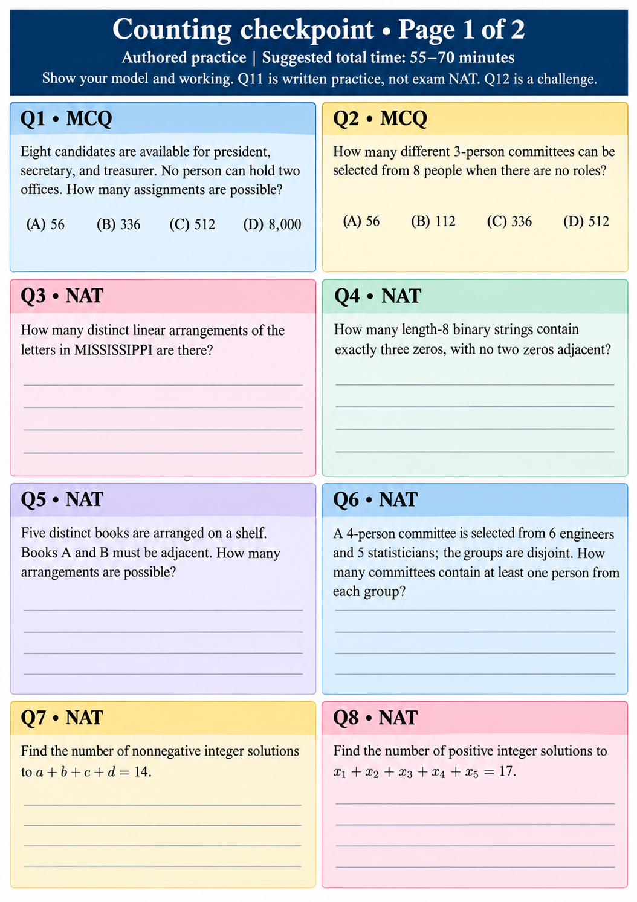

# Counting checkpoint • Page 1 of 2
Authored practice | Suggested total time: 55–70 minutes
Show your model and working. Q11 is written practice, not exam NAT. Q12 is a challenge.

## Q1 • MCQ
Eight candidates are available for president, secretary, and treasurer. No person can hold two offices. How many assignments are possible?
(A) 56  (B) 336  (C) 512  (D) 8,000

## Q2 • MCQ
How many different 3-person committees can be selected from 8 people when there are no roles?
(A) 56  (B) 112  (C) 336  (D) 512

## Q3 • NAT
How many distinct linear arrangements of the letters in MISSISSIPPI are there?

## Q4 • NAT
How many length-8 binary strings contain exactly three zeros, with no two zeros adjacent?

## Q5 • NAT
Five distinct books are arranged on a shelf. Books A and B must be adjacent. How many arrangements are possible?

## Q6 • NAT
A 4-person committee is selected from 6 engineers and 5 statisticians; the groups are disjoint. How many committees contain at least one person from each group?

## Q7 • NAT
Find the number of nonnegative integer solutions to a+b+c+d=14.

## Q8 • NAT
Find the number of positive integer solutions to x₁+x₂+x₃+x₄+x₅=17.
