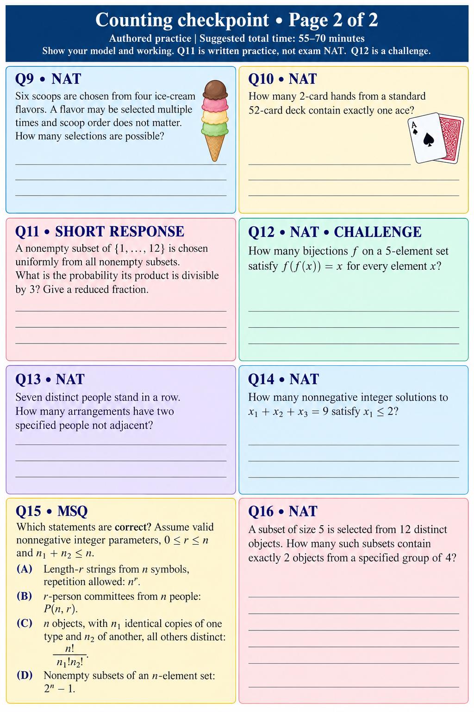

# Counting checkpoint • Page 2 of 2
Authored practice | Suggested total time: 55–70 minutes
Show your model and working. Q11 is written practice, not exam NAT. Q12 is a challenge.

## Q9 • NAT
Six scoops are chosen from four ice-cream flavors. A flavor may be selected multiple times and scoop order does not matter. How many selections are possible?

## Q10 • NAT
How many 2-card hands from a standard 52-card deck contain exactly one ace?

## Q11 • SHORT RESPONSE
A nonempty subset of {1,…,12} is chosen uniformly from all nonempty subsets. What is the probability its product is divisible by 3? Give a reduced fraction.

## Q12 • NAT • CHALLENGE
How many bijections f on a 5-element set satisfy f(f(x))=x for every element x?

## Q13 • NAT
Seven distinct people stand in a row. How many arrangements have two specified people not adjacent?

## Q14 • NAT
How many nonnegative integer solutions to x₁+x₂+x₃=9 satisfy x₁≤2?

## Q15 • MSQ
Which statements are correct? Assume valid nonnegative integer parameters, 0≤r≤n and n₁+n₂≤n.
(A) Length-r strings from n symbols, repetition allowed: n^r.
(B) r-person committees from n people: P(n,r).
(C) n objects, with n₁ identical copies of one type and n₂ of another, all others distinct: n!/(n₁!n₂!).
(D) Nonempty subsets of an n-element set: 2^n−1.

## Q16 • NAT
A subset of size 5 is selected from 12 distinct objects. How many such subsets contain exactly 2 objects from a specified group of 4?
