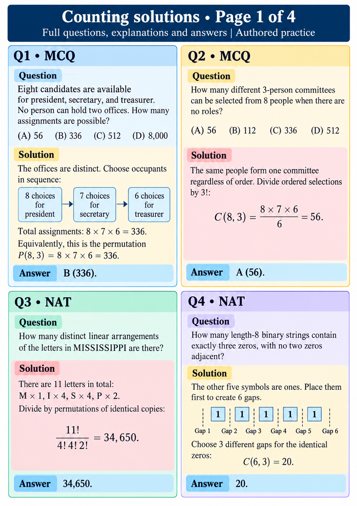

# Counting solutions • Page 1 of 4
Full questions, explanations and answers | Authored practice

## Q1 • MCQ
Question: Eight candidates are available for president, secretary, and treasurer. No person can hold two offices. How many assignments are possible?
(A) 56  (B) 336  (C) 512  (D) 8,000

Solution: The offices are distinct. Choose occupants in sequence: 8×7×6=336. Equivalently P(8,3).
Answer: B (336).

## Q2 • MCQ
Question: How many different 3-person committees can be selected from 8 people when there are no roles?
(A) 56  (B) 112  (C) 336  (D) 512

Solution: The same people form one committee regardless of order. Divide ordered selections by 3!: C(8,3)=(8×7×6)/6=56.
Answer: A (56).

## Q3 • NAT
Question: How many distinct linear arrangements of the letters in MISSISSIPPI are there?

Solution: 11 letters: M×1, I×4, S×4, P×2. Divide by permutations of identical copies: 11!/(4!4!2!)=34,650.
Answer: 34,650.

## Q4 • NAT
Question: How many length-8 binary strings contain exactly three zeros, with no two zeros adjacent?

Solution: The other five symbols are ones. Place them first to create 6 gaps. Choose 3 different gaps for the identical zeros: C(6,3)=20.
Answer: 20.
