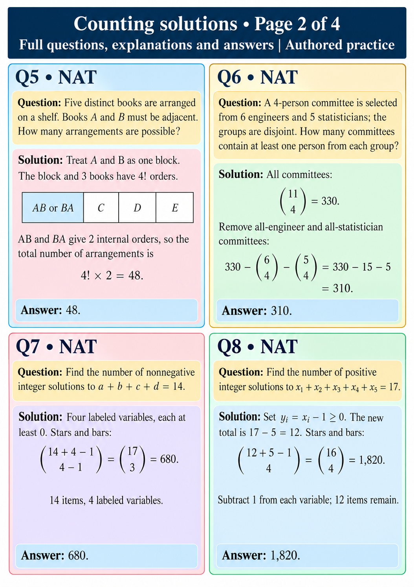

# Counting solutions • Page 2 of 4
Full questions, explanations and answers | Authored practice

## Q5 • NAT
Question: Five distinct books are arranged on a shelf. Books A and B must be adjacent. How many arrangements are possible?

Solution: Treat A and B as one block. The block and 3 books have 4! orders. AB and BA give 2 internal orders: 4!×2=48.
Answer: 48.

## Q6 • NAT
Question: A 4-person committee is selected from 6 engineers and 5 statisticians; the groups are disjoint. How many committees contain at least one person from each group?

Solution: All committees: C(11,4)=330. Remove all-engineer and all-statistician committees: 330−C(6,4)−C(5,4)=330−15−5=310.
Answer: 310.

## Q7 • NAT
Question: Find the number of nonnegative integer solutions to a+b+c+d=14.

Solution: Four labeled variables, each at least 0. Stars and bars: C(14+4−1,4−1)=C(17,3)=680.
Answer: 680.

## Q8 • NAT
Question: Find the number of positive integer solutions to x₁+x₂+x₃+x₄+x₅=17.

Solution: Set yᵢ=xᵢ−1≥0. The new total is 17−5=12. Stars and bars: C(12+5−1,4)=C(16,4)=1,820.
Answer: 1,820.
