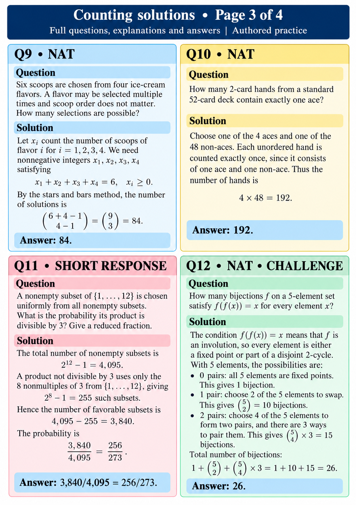

# Counting solutions • Page 3 of 4
Full questions, explanations and answers | Authored practice

## Q9 • NAT
Question: Six scoops are chosen from four ice-cream flavors. A flavor may be selected multiple times and scoop order does not matter. How many selections are possible?

Solution: Let xᵢ count scoops of flavor i. Then x₁+x₂+x₃+x₄=6, xᵢ≥0. Count C(9,3)=84.
Answer: 84.

## Q10 • NAT
Question: How many 2-card hands from a standard 52-card deck contain exactly one ace?

Solution: Choose one of 4 aces and one of 48 non-aces. Each unordered hand is counted exactly once: 4×48=192.
Answer: 192.

## Q11 • SHORT RESPONSE
Question: A nonempty subset of {1,…,12} is chosen uniformly from all nonempty subsets. What is the probability its product is divisible by 3? Give a reduced fraction.

Solution: Total nonempty subsets: 2^12−1=4,095. A product not divisible by 3 uses only the 8 nonmultiples of 3: 2^8−1=255 subsets. Favorable: 4,095−255=3,840.
Answer: 3,840/4,095=256/273.

## Q12 • NAT • CHALLENGE
Question: How many bijections f on a 5-element set satisfy f(f(x))=x for every element x?

Solution: Only fixed points and disjoint pairs are possible. Count 0, 1, or 2 pairs: 1+C(5,2)+C(5,4)×3=1+10+15=26.
Answer: 26.
