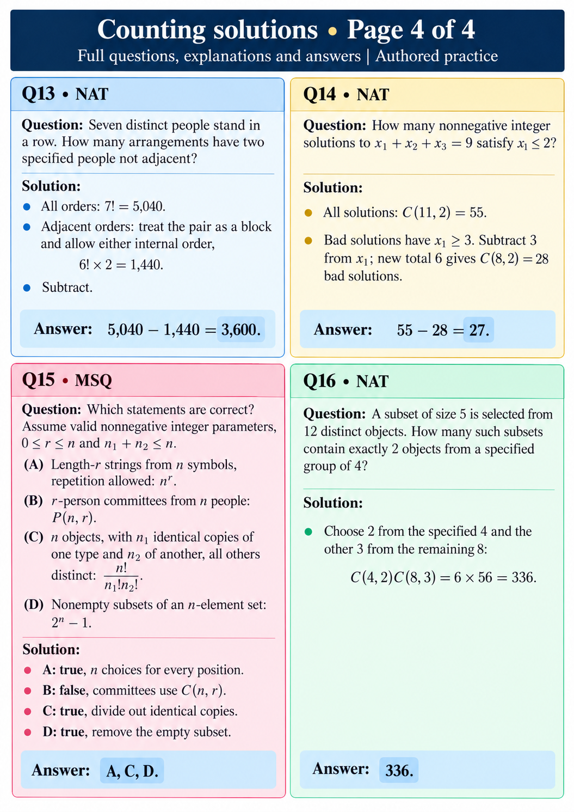

# Counting solutions • Page 4 of 4
Full questions, explanations and answers | Authored practice

## Q13 • NAT
Question: Seven distinct people stand in a row. How many arrangements have two specified people not adjacent?

Solution: All orders: 7!=5,040. Adjacent orders: treat the pair as a block and allow either internal order, 6!×2=1,440. Subtract.
Answer: 5,040−1,440=3,600.

## Q14 • NAT
Question: How many nonnegative integer solutions to x₁+x₂+x₃=9 satisfy x₁≤2?

Solution: All solutions: C(11,2)=55. Bad solutions have x₁≥3. Subtract 3 from x₁; new total 6 gives C(8,2)=28 bad solutions.
Answer: 55−28=27.

## Q15 • MSQ
Question: Which statements are correct? Assume valid nonnegative integer parameters, 0≤r≤n and n₁+n₂≤n.
(A) Length-r strings from n symbols, repetition allowed: n^r.
(B) r-person committees from n people: P(n,r).
(C) n objects, with n₁ identical copies of one type and n₂ of another, all others distinct: n!/(n₁!n₂!).
(D) Nonempty subsets of an n-element set: 2^n−1.

Solution: A: true, n choices for every position. B: false, committees use C(n,r). C: true, divide out identical copies. D: true, remove the empty subset.
Answer: A, C, D.

## Q16 • NAT
Question: A subset of size 5 is selected from 12 distinct objects. How many such subsets contain exactly 2 objects from a specified group of 4?

Solution: Choose 2 from the specified 4 and the other 3 from the remaining 8: C(4,2)C(8,3)=6×56=336.
Answer: 336.
