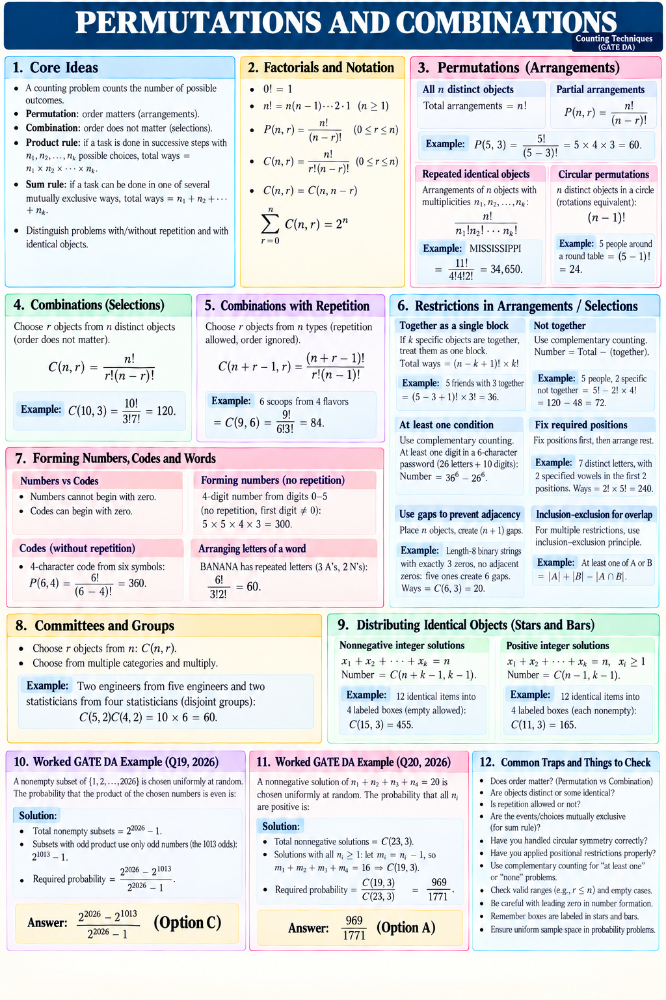

# Counting — restart edition

Prepared 1 November 2026. This is the active first topic of the restarted revision sequence.

**Material status:** ready. **Study status:** unreported. **Checkpoint:** unattempted.

## Primary revision sheet

Start with the [compact overview](00_Compact_Overview.md): a single dense page in the user's twelve-panel reference style, covering core formulas, restrictions, short worked examples and two official DA PYQs.

## Read and print

Every PNG is in the sibling `PNG/` folder. Print filenames 00–10 in ascending order, portrait, one page per sheet, using Fit to page. Page 00 is the primary compact sheet; pages 01–04 provide expanded explanations; 05–06 are the checkpoint; 07–10 contain the full questions and worked solutions. All are in the same PNG folder for one print job.

The Markdown files are the editable sources. A content change requires the corresponding PNG to be regenerated and checked.

1. [Models and core formulas](01_Models_and_Core_Formulas.md)
2. [Restrictions and casework](02_Restrictions_and_Casework.md)
3. [Stars and bars; outcome models](03_Stars_Bars_and_Outcome_Models.md)
4. [Verified PYQs and challenge](04_Verified_PYQs_and_Challenge.md)
5. [Checkpoint Q1–8](05_Checkpoint_Q1_8.md)
6. [Checkpoint Q9–16](06_Checkpoint_Q9_16.md)
7. [Solutions Q1–4](07_Solutions_Q1_4.md)
8. [Solutions Q5–8](08_Solutions_Q5_8.md)
9. [Solutions Q9–12](09_Solutions_Q9_12.md)
10. [Solutions Q13–16](10_Solutions_Q13_16.md)

## How to use this topic

Read the compact overview first. Use the expanded lessons when you need more explanation. Read each worked example, cover its solution, and reproduce the reasoning. Then attempt the checkpoint without the solution pages. Send your answers, working, time spent and uncertain questions. We will record errors by cause: model choice, overcounting, restrictions, probability denominator, or arithmetic.

The 16 checkpoint questions are authored practice. Q11 asks for a written fraction and is not an exam NAT item. Q12 is an optional challenge. The core checkpoint is the other 15 questions; the challenge is reviewed separately and does not block core completion.

These questions were retained or clarified from the previous draft, so they measure practice rather than performance on unseen questions.

## References and workflow

- [Source and checking record](Sources_and_Checks.md)
- [Production SOP](Production_SOP.md)
- [ImageGen prompt set](Image_Prompts.md)

Next topic: Probability Foundations, to be rebuilt after Counting in the same format. No study hours, scores, or completed days are inferred from preparing these files.
