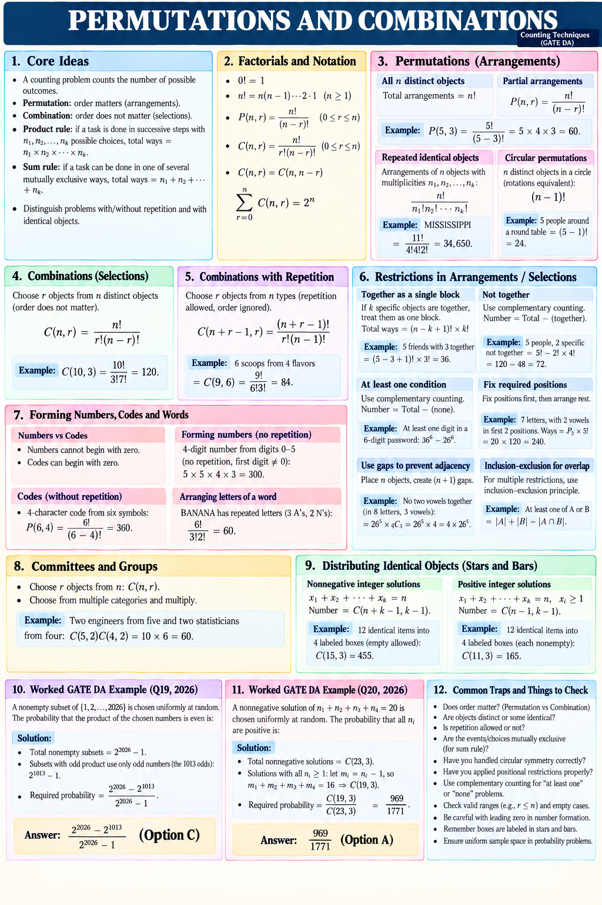

# Counting Overview — Quick Sheet

Use this single-page map for review after studying the individual lessons. The detailed explanations and derivations are in Lessons 1–4.

**Scope:** outcome models, factorials, permutations, combinations, repeated objects, restrictions, strings and codes, committees, stars and bars, and verified official GATE DA examples.

