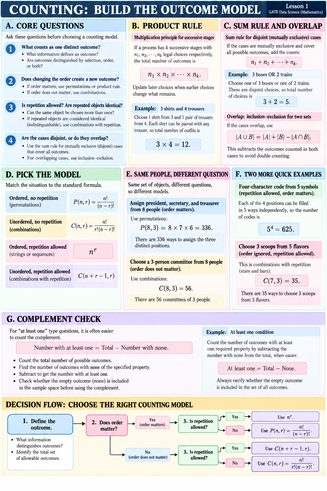

# Lesson 1 — Foundations and Model Choice

**Goal:** define the outcome before selecting a counting formula.

## Define one outcome

Write down what one valid outcome contains. A committee is a set of people; assigning president, secretary, and treasurer is an ordered assignment because the roles differ. Then check whether objects are distinct, whether an object may be reused, and whether the empty outcome is included.

## Product rule: successive choices

If a result is built in successive stages with `n1, n2, ..., nk` legal choices at each stage, the total is `n1 × n2 × ... × nk`. Update later choice counts when an earlier choice changes what remains. Example: choosing one shirt from 3 and one pair of trousers from 4 gives `3 × 4 = 12` outfits.

## Sum rule: mutually exclusive cases

Add counts only when the cases cannot occur together and cover every valid outcome: `n1 + n2 + ... + nk`. Choosing one of 3 buses or one of 2 trains gives `3 + 2 = 5` choices.

For overlapping sets, remove double counting: `|A ∪ B| = |A| + |B| - |A ∩ B|`.

## Match order and repetition to the model

| Order matters? | Repetition? | Model | Count |
| --- | --- | --- | --- |
| Yes | No | Permutation | `P(n,r) = n!/(n-r)!` |
| No | No | Combination | `C(n,r) = n!/[r!(n-r)!]` |
| Yes | Yes | Ordered string | `n^r` |
| No | Yes | Combination with repetition | `C(n+r-1,r)` |

For ordinary permutations and combinations, `0 ≤ r ≤ n`.

## Same people, different question

- Assign three offices from eight people: `P(8,3) = 8 × 7 × 6 = 336`.
- Choose a three-person committee from eight: `C(8,3) = 56`.

The set of people is the same; the offices distinguish outcomes while a committee does not.

## Repetition examples

- Four-character code from five symbols, reuse allowed: `5^4 = 625`.
- Choose three scoops from five flavors, reuse allowed and order ignored: `C(5+3-1,3) = C(7,3) = 35`.

## Complement counting

For an “at least one” condition, it may be shorter to count all outcomes and subtract those with none. Check whether the empty outcome belongs to the sample space.

