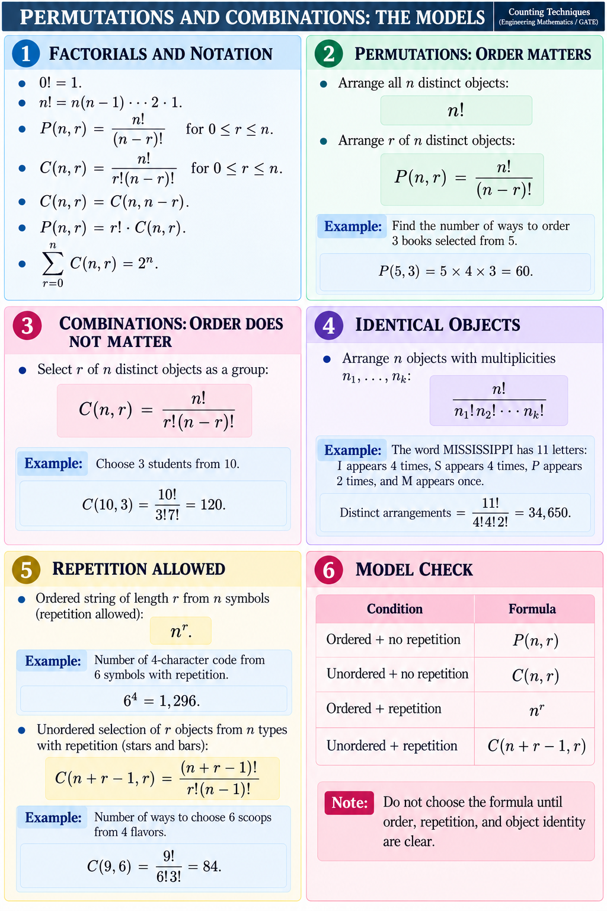

# Lesson 2 — Permutations, Combinations, and Repetition

## Factorials

For a nonnegative integer `n`, `n! = n(n-1)···2·1`, and `0! = 1`.

## Permutations: order matters

An ordered selection of `r` distinct objects from `n` is `P(n,r) = n!/(n-r)!`. For example, ordering 3 books selected from 5 gives `P(5,3)=5×4×3=60`. Arranging all `n` distinct objects gives `n!`.

## Combinations: order does not matter

A group of `r` distinct objects selected from `n` is `C(n,r) = n!/[r!(n-r)!]`. Choosing 3 students from 10 gives `C(10,3)=120`. Also `C(n,r)=C(n,n-r)` and `P(n,r)=r!C(n,r)`.

The sum `Σ C(n,r) = 2^n` for `r=0,...,n` counts every subset of an `n`-element set.

## Repeated objects

If `n` objects include indistinguishable groups of sizes `n1,...,nk`, the number of distinct arrangements is `n!/(n1! n2! ... nk!)`.

MISSISSIPPI has 11 letters: I appears 4 times, S appears 4 times, and P appears 2 times. Its distinct arrangements are `11!/(4!4!2!)=34,650`.

## Repetition allowed

- Ordered string of length `r` from `n` symbols: `n^r`. A 4-character code from 6 symbols has `6^4=1,296` possibilities if repetition is allowed.
- Unordered selection of `r` objects from `n` types with repetition: `C(n+r-1,r)`. Six scoops from four flavors gives `C(9,6)=84`.

Before applying a formula, check order, reuse, object identity, and the number of positions or selected objects.

