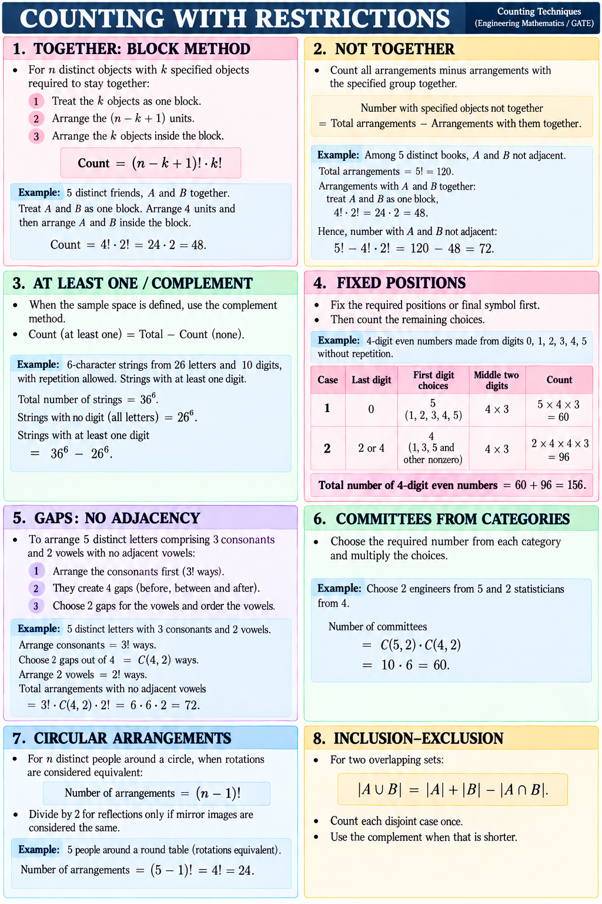

# Lesson 3 — Restrictions and Structured Counts

## Specified objects together

For `n` distinct objects with a specified group of `k` that must stay together, treat the group as one block. Arrange the `n-k+1` units and then arrange the `k` objects inside the block: `(n-k+1)! × k!`.

Five distinct friends with A and B adjacent: `4! × 2! = 48`.

## Specified objects not together

Subtract the arrangements with the group together from the unrestricted total. Among five distinct books, A and B not adjacent gives `5! - 4!×2! = 120-48=72`.

## At least one: complement method

Count all outcomes and subtract those with none of the required property. For six-character strings over 26 letters and 10 digits, with repetition allowed, strings containing at least one digit are `36^6 - 26^6`.

## Fixed positions: even four-digit numbers

Form a 4-digit even number from `0,1,2,3,4,5` without repetition. Split by the final digit:

- Last digit 0: first digit has 5 choices; middle positions have `4×3`. Count: `5×4×3=60`.
- Last digit 2 or 4: 2 choices for the last digit; 4 nonzero choices for the first; then `4×3` for the middle. Count: `2×4×4×3=96`.

Total: `60+96=156`. This handles the leading-zero restriction and counts every even final digit once.

## Gaps prevent adjacency

Arrange three distinct consonants first: `3!` ways. They create four gaps. Choose two gaps for two distinct vowels, then arrange the vowels: `C(4,2)×2!` ways. Total with no adjacent vowels: `3!×C(4,2)×2!=72`.

## Choose by category

For a committee with 2 engineers from 5 and 2 statisticians from 4, choose within each category and multiply: `C(5,2)×C(4,2)=10×6=60`.

## Circular arrangements

When rotations of `n` distinct people around a circle are equivalent, fix one person and arrange the rest: `(n-1)!`. Five people around a table give `4!=24`. Divide by 2 for reflections only when mirror images are explicitly equivalent.

## Inclusion-exclusion

For two sets with overlap, `|A∪B|=|A|+|B|-|A∩B|`. Make cases disjoint or use inclusion-exclusion. Use a complement if it simplifies the count.

