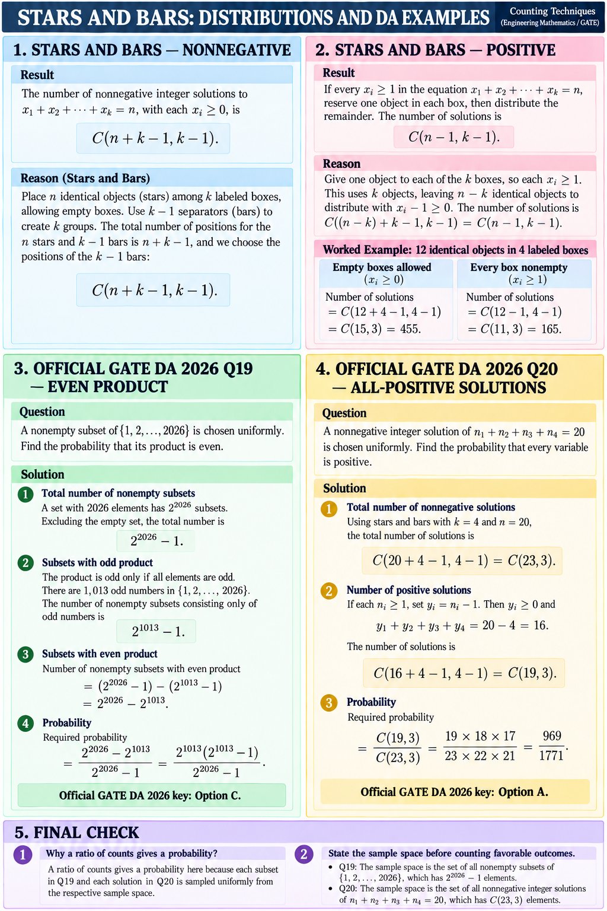

# Lesson 4 — Stars and Bars and Official DA Examples

## Nonnegative integer solutions

The number of solutions to `x1+...+xk=n` with every `xi≥0` is `C(n+k-1,k-1)`. Interpret this as distributing `n` identical objects among `k` labeled boxes; boxes may be empty.

## Positive integer solutions

If every `xi≥1`, reserve one object in each box, then distribute the remaining `n-k` objects. The count is `C(n-1,k-1)`.

For 12 identical objects in 4 labeled boxes: empty boxes allowed gives `C(15,3)=455`; every box nonempty gives `C(11,3)=165`.

## GATE DA 2026 Q19 — even product

A nonempty subset of `{1,...,2026}` is chosen uniformly. Total subsets: `2^2026-1`. A product is odd exactly when every selected element is odd. There are 1,013 odd elements, so nonempty odd-product subsets number `2^1013-1`.

Even-product subsets number `(2^2026-1)-(2^1013-1)=2^2026-2^1013`. Therefore,

`P(even product) = (2^2026-2^1013)/(2^2026-1) = 2^1013(2^1013-1)/(2^2026-1)`.

The official final key gives option C.

## GATE DA 2026 Q20 — all variables positive

A nonnegative integer solution of `n1+n2+n3+n4=20` is chosen uniformly. Total solutions: `C(23,3)`.

For positive solutions, set `yi=ni-1`. Then `y1+y2+y3+y4=16`, with each `yi≥0`, so favorable solutions number `C(19,3)`. Thus

`P(all positive) = C(19,3)/C(23,3) = 969/1771`.

The official final key gives option A. A ratio of counts is valid here because the solution is chosen uniformly.

## Sources

- [Official GATE 2027 DA syllabus](../../../../DA_GATE2027_Syllabus.pdf)
- [Official GATE DA 2026 question paper](../../../../Resources/Gate%20DA%20previous%20year%20question%20papers%20and%20answer%20keys/GATE_DA_2026_Question_Paper-49f04ab2.pdf), Q19–Q20.
- [Official GATE DA 2026 final answer key](../../../../Resources/Gate%20DA%20previous%20year%20question%20papers%20and%20answer%20keys/GATE_DA_2026_Final_Answer_Key-0ff3c22c.pdf), Q19–Q20.

