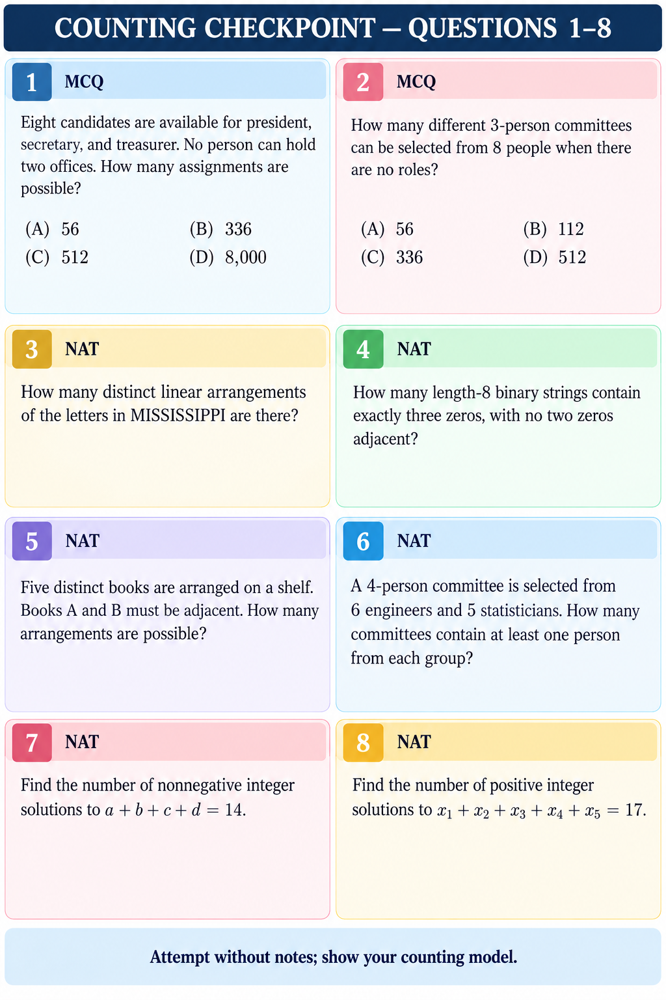
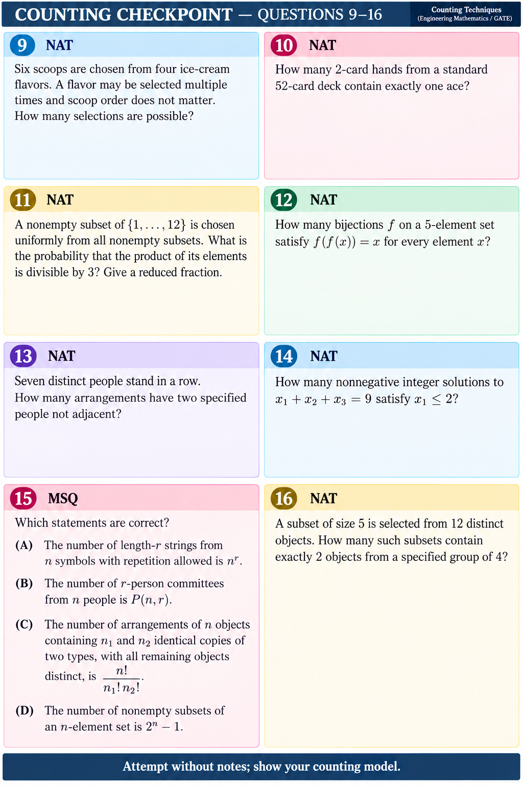

# Counting — GATE DA 2027 Checkpoint

**Suggested time:** 55–70 minutes. Attempt after Lessons 1–4. Show the outcome model and counting method, not only the final number. For probability questions, state the denominator and why outcomes are equally likely. Mark guesses. This checkpoint has no answer key.

## Questions 1–8

### Q1 · MCQ
Eight candidates are available for president, secretary, and treasurer. No person can hold two offices. How many assignments are possible?

(A) 56 · (B) 336 · (C) 512 · (D) 8,000

### Q2 · MCQ
How many different 3-person committees can be selected from 8 people when there are no roles?

(A) 56 · (B) 112 · (C) 336 · (D) 512

### Q3 · NAT
How many distinct linear arrangements of the letters in MISSISSIPPI are there?

### Q4 · NAT
How many length-8 binary strings contain exactly three zeros, with no two zeros adjacent?

### Q5 · NAT
Five distinct books are arranged on a shelf. Books A and B must be adjacent. How many arrangements are possible?

### Q6 · NAT
A 4-person committee is selected from 6 engineers and 5 statisticians. How many committees contain at least one person from each group?

### Q7 · NAT
Find the number of nonnegative integer solutions to `a+b+c+d=14`.

### Q8 · NAT
Find the number of positive integer solutions to `x1+x2+x3+x4+x5=17`.

## Questions 9–16

### Q9 · NAT
Six scoops are chosen from four ice-cream flavors. A flavor may be selected multiple times and scoop order does not matter. How many selections are possible?

### Q10 · NAT
How many 2-card hands from a standard 52-card deck contain exactly one ace?

### Q11 · NAT
A nonempty subset of `{1,...,12}` is chosen uniformly from all nonempty subsets. What is the probability that the product of its elements is divisible by 3? Give a reduced fraction.

### Q12 · NAT
How many bijections `f` on a 5-element set satisfy `f(f(x))=x` for every element `x`?

### Q13 · NAT
Seven distinct people stand in a row. How many arrangements have two specified people not adjacent?

### Q14 · NAT
How many nonnegative integer solutions to `x1+x2+x3=9` satisfy `x1≤2`?

### Q15 · MSQ
Which statements are correct?

(A) The number of length-`r` strings from `n` symbols with repetition allowed is `n^r`.

(B) The number of `r`-person committees from `n` people is `P(n,r)`.

(C) The number of arrangements of `n` objects containing `n1` and `n2` identical copies of two types, with all remaining objects distinct, is `n!/(n1!n2!)`.

(D) The number of nonempty subsets of an `n`-element set is `2^n-1`.

### Q16 · NAT
A subset of size 5 is selected from 12 distinct objects. How many such subsets contain exactly 2 objects from a specified group of 4?

## After your attempt

Send answers Q1–Q16 with working. A separate solutions Markdown file and PNG pages will be prepared after you attempt the checkpoint.

