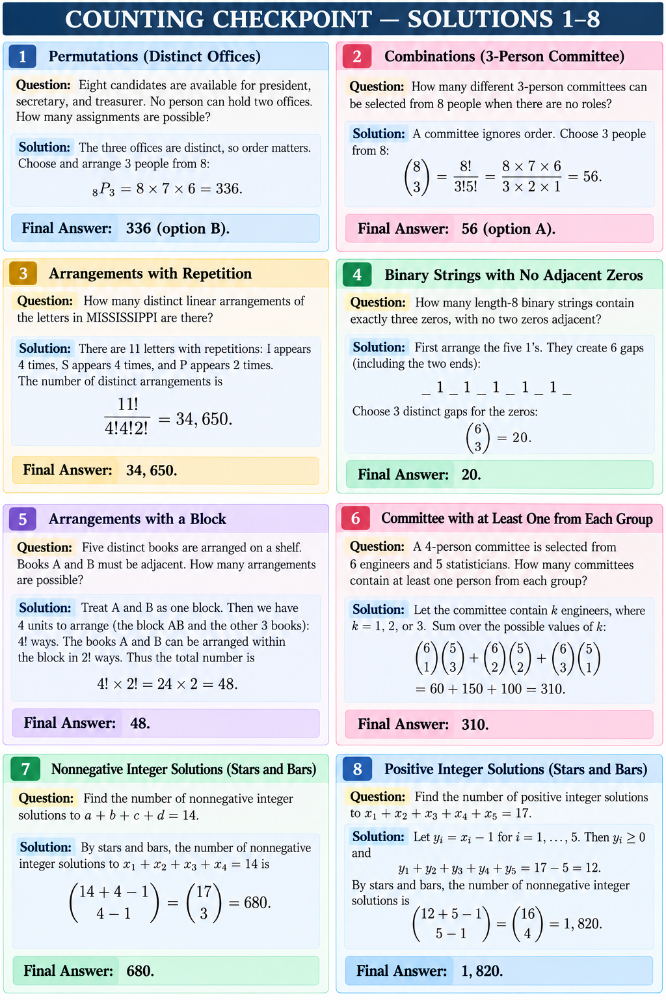
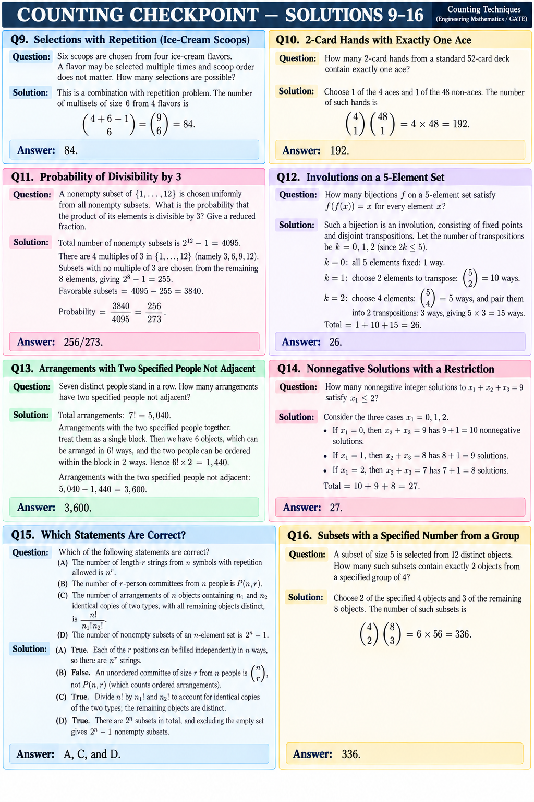

# Counting Checkpoint — Worked Solutions

**Separate answer sheet.** Each solution repeats the full question so it can be printed independently. The checkpoint file itself remains answer-free. For a closed-book attempt, try the checkpoint before viewing this sheet.

## Questions 1–8

### Q1 · MCQ

Eight candidates are available for president, secretary, and treasurer. No person can hold two offices. How many assignments are possible?

The three offices are distinct, so order matters. `P(8,3)=8×7×6=336`.

**Answer: 336 (B).**

### Q2 · MCQ

How many different 3-person committees can be selected from 8 people when there are no roles?

A committee ignores order. `C(8,3)=8!/(3!5!)=56`.

**Answer: 56 (A).**

### Q3 · NAT

How many distinct linear arrangements of the letters in MISSISSIPPI are there?

There are 11 letters: I repeats 4 times, S repeats 4 times, and P repeats 2 times. Divide `11!` by the factorials of those repeated counts: `11!/(4!4!2!)=34,650`.

**Answer: 34,650.**

### Q4 · NAT

How many length-8 binary strings contain exactly three zeros, with no two zeros adjacent?

Arrange the five ones first. Their two ends and four internal spaces make 6 gaps. Choose 3 distinct gaps for the zeros: `C(6,3)=20`.

**Answer: 20.**

### Q5 · NAT

Five distinct books are arranged on a shelf. Books A and B must be adjacent. How many arrangements are possible?

Treat A and B as one block. Arrange the block and the other three books in `4!` ways, then arrange A and B inside the block in `2!` ways: `4!×2!=48`.

**Answer: 48.**

### Q6 · NAT

A 4-person committee is selected from 6 engineers and 5 statisticians. How many committees contain at least one person from each group?

Count committees with 1, 2, or 3 engineers:
`C(6,1)C(5,3)+C(6,2)C(5,2)+C(6,3)C(5,1)=60+150+100=310`.

**Answer: 310.**

### Q7 · NAT

Find the number of nonnegative integer solutions to `a+b+c+d=14`.

Stars and bars gives `C(14+4-1,4-1)=C(17,3)=680`.

**Answer: 680.**

### Q8 · NAT

Find the number of positive integer solutions to `x1+x2+x3+x4+x5=17`.

Set `yi=xi-1`. Then each `yi≥0` and `y1+...+y5=12`. Count: `C(12+5-1,5-1)=C(16,4)=1,820`.

**Answer: 1,820.**

## Questions 9–16

### Q9 · NAT

Six scoops are chosen from four ice-cream flavors. A flavor may be selected multiple times and scoop order does not matter. How many selections are possible?

Use combinations with repetition: `C(4+6-1,6)=C(9,6)=84`.

**Answer: 84.**

### Q10 · NAT

How many 2-card hands from a standard 52-card deck contain exactly one ace?

Choose 1 of the 4 aces and 1 of the 48 non-aces: `C(4,1)C(48,1)=192`.

**Answer: 192.**

### Q11 · NAT

A nonempty subset of `{1,...,12}` is chosen uniformly from all nonempty subsets. What is the probability that the product of its elements is divisible by 3? Give a reduced fraction.

There are `2^12-1=4,095` nonempty subsets. A product is not divisible by 3 exactly when the subset contains none of the four multiples of 3. There are 8 other numbers, so there are `2^8-1=255` nonempty subsets with no multiple of 3. Favorable subsets: `4,095-255=3,840`. Thus `3,840/4,095=256/273`.

**Answer: 256/273.**

### Q12 · NAT

How many bijections `f` on a 5-element set satisfy `f(f(x))=x` for every element `x`?

Such a bijection is an involution composed of fixed points and disjoint transpositions. Count 0, 1, or 2 transpositions: `1+C(5,2)+C(5,4)×3=1+10+15=26`.

**Answer: 26.**

### Q13 · NAT

Seven distinct people stand in a row. How many arrangements have two specified people not adjacent?

Total arrangements: `7!=5,040`. If the two specified people are adjacent, treat them as a block: `6!×2!=1,440`. Subtract: `5,040-1,440=3,600`.

**Answer: 3,600.**

### Q14 · NAT

How many nonnegative integer solutions to `x1+x2+x3=9` satisfy `x1≤2`?

Split into `x1=0,1,2`. The remaining pair sums to 9, 8, and 7, giving 10, 9, and 8 nonnegative solutions respectively. Total: `10+9+8=27`.

**Answer: 27.**

### Q15 · MSQ

Which statements are correct?

(A) The number of length-`r` strings from `n` symbols with repetition allowed is `n^r`.

(B) The number of `r`-person committees from `n` people is `P(n,r)`.

(C) The number of arrangements of `n` objects containing `n1` and `n2` identical copies of two types, with all remaining objects distinct, is `n!/(n1!n2!)`.

(D) The number of nonempty subsets of an `n`-element set is `2^n-1`.

A is true because each position has `n` choices. B is false because a committee is unordered and counted by `C(n,r)`. C is true because identical copies are indistinguishable. D is true because there are `2^n` subsets including the empty set.

**Answer: A, C, and D.**

### Q16 · NAT

A subset of size 5 is selected from 12 distinct objects. How many such subsets contain exactly 2 objects from a specified group of 4?

Choose 2 from the specified 4 and 3 from the other 8: `C(4,2)C(8,3)=6×56=336`.

**Answer: 336.**

