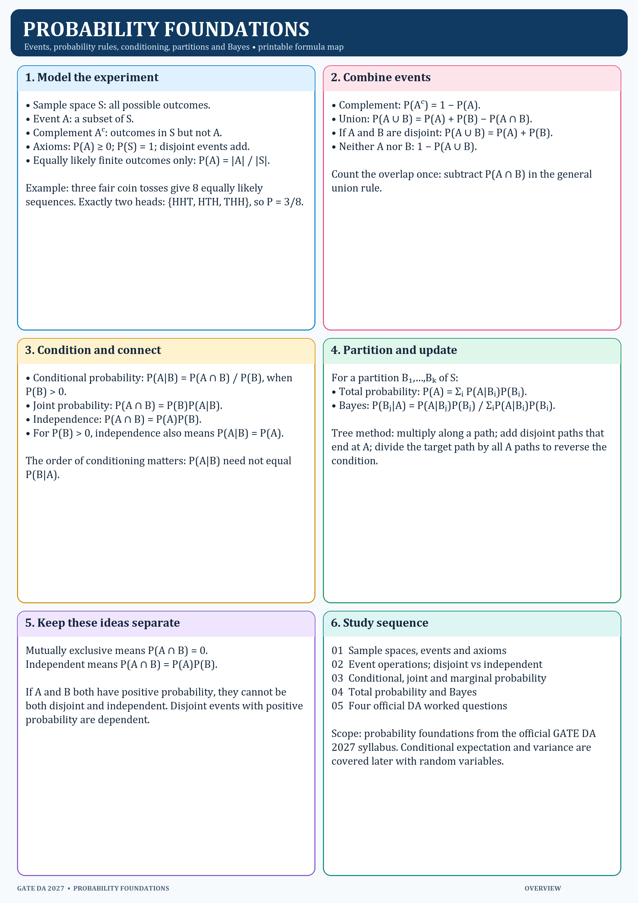

# Probability Foundations — quick overview

Use this page to recall the order of the method: define the sample space, translate the event, choose the right rule, and check the condition or overlap.

Core rules:

- `P(Aᶜ) = 1 − P(A)`
- `P(A ∪ B) = P(A) + P(B) − P(A ∩ B)`
- `P(A | B) = P(A ∩ B) / P(B)`, when `P(B) > 0`
- `P(A ∩ B) = P(B)P(A | B)`
- Independence: `P(A ∩ B) = P(A)P(B)`
- Partition: `P(A) = Σᵢ P(A | Bᵢ)P(Bᵢ)`
- Bayes: `P(Bⱼ | A) = P(A | Bⱼ)P(Bⱼ) / P(A)`
