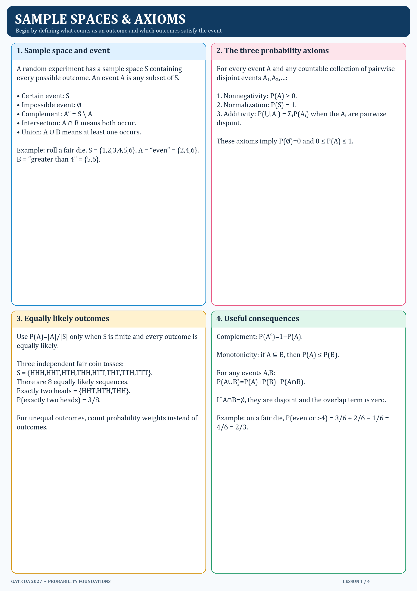

# 1. Sample spaces and axioms

## Definitions

A sample space `S` contains every possible outcome of the experiment. An event `A` is a subset of `S`. The certain event is `S`; the impossible event is `∅`. The complement `Aᶜ` contains outcomes in `S` that are not in `A`.

## Probability axioms

1. `P(A) ≥ 0`.
2. `P(S) = 1`.
3. If events `Aᵢ` are pairwise disjoint, `P(⋃ᵢ Aᵢ) = ΣᵢP(Aᵢ)`.

Consequences include `P(∅)=0`, `P(Aᶜ)=1−P(A)`, and `A⊆B ⇒ P(A)≤P(B)`.

For a finite, equally likely sample space, `P(A)=|A|/|S|`. Do not use this counting shortcut unless the outcomes are equally likely.

## Worked example

Three fair coin tosses have eight equally likely sequences. Exactly two heads occurs in `HHT`, `HTH`, or `THH`, so `P=3/8`.
