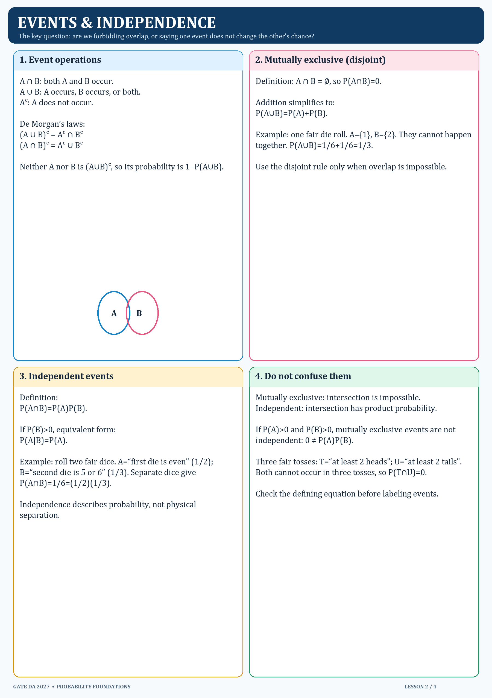

# 2. Event operations and independence

## Event operations

- `A∩B`: both occur.
- `A∪B`: at least one occurs.
- `Aᶜ`: A does not occur.
- Inclusion–exclusion: `P(A∪B)=P(A)+P(B)−P(A∩B)`.

## Disjoint vs independent

Mutually exclusive (disjoint) means `A∩B=∅`, hence `P(A∩B)=0`. Independent means `P(A∩B)=P(A)P(B)`. If both events have positive probability, they cannot be both disjoint and independent.

For `P(B)>0`, independence is also equivalent to `P(A|B)=P(A)`. Always check the defining equation.

## Official DA example

GATE DA 2024 Q12: among three tosses, “at least two heads” and “at least two tails” cannot both happen, so the intersection probability is zero. The official final key gives option A. See [worked questions](04_Official_DA_Worked_Examples.md).
