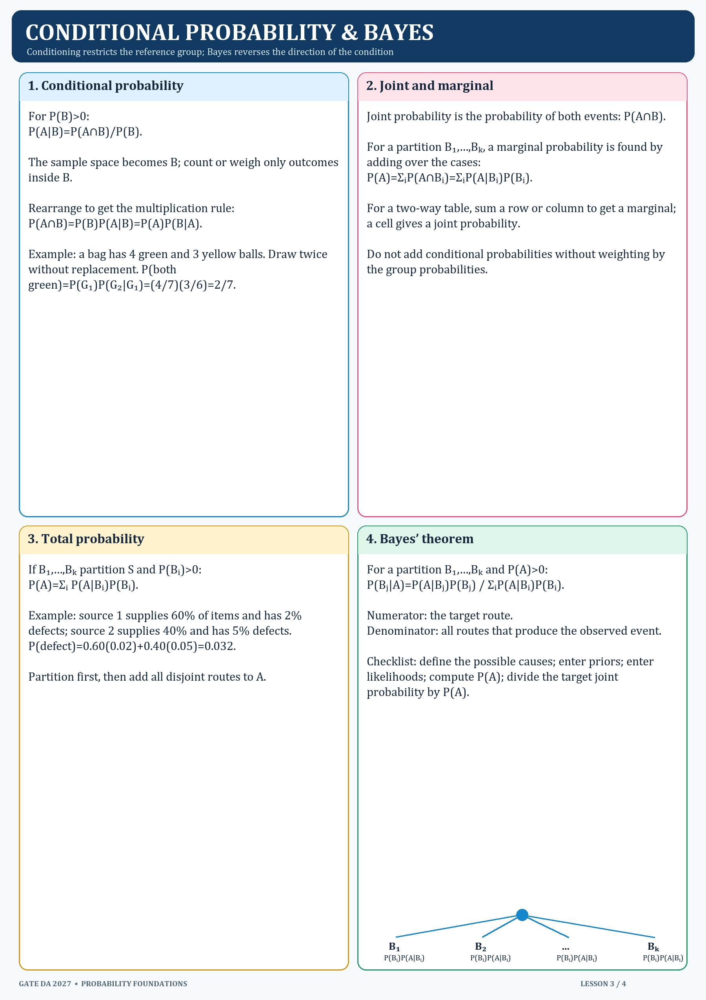

# 3. Conditional, joint, marginal probability and Bayes

## Conditional and joint probability

For `P(B)>0`, `P(A|B)=P(A∩B)/P(B)`. The condition changes the reference group to outcomes in B. Rearranging gives `P(A∩B)=P(B)P(A|B)`.

A joint probability describes both events. A marginal probability sums over the cases in a partition. For partition events `Bᵢ`, `P(A)=ΣᵢP(A|Bᵢ)P(Bᵢ)`.

## Total probability and Bayes

`P(A)=ΣᵢP(A|Bᵢ)P(Bᵢ)`. Bayes reverses the condition: `P(Bⱼ|A)=P(A|Bⱼ)P(Bⱼ)/P(A)`. The denominator includes every disjoint route that could have produced A.

### Checklist

1. List the possible causes as a partition.
2. Write each prior probability.
3. Write the likelihood of the observed event under each cause.
4. Add weighted likelihoods to find the total probability of the observation.
5. Divide the target joint probability by that total.
