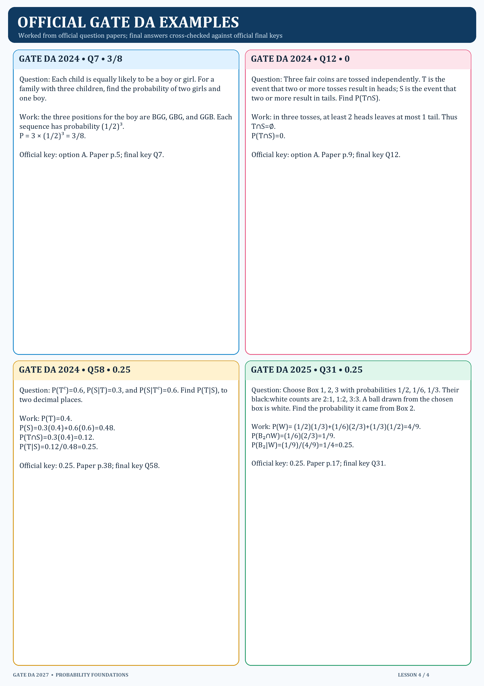

# 4. Official GATE DA worked examples

Each result below was checked against the final answer key.

## GATE DA 2024 Q7 — exactly two girls

A child is equally likely to be a boy or a girl. For a family with three children, the probability of two girls and one boy is `C(3,1)(1/2)³=3/8`. Official answer: option A. Source: 2024 official paper p.5; final key Q7.

## GATE DA 2024 Q12 — disjoint events

For three fair tosses, T means at least two heads and S at least two tails. These conditions cannot both hold, so `P(T∩S)=0`. Official answer: option A. Source: 2024 paper p.9; final key Q12.

## GATE DA 2024 Q58 — reverse the condition

Given `P(Tᶜ)=0.6`, `P(S|T)=0.3`, `P(S|Tᶜ)=0.6`, obtain `P(T)=0.4`, `P(S)=0.3(0.4)+0.6(0.6)=0.48`, and `P(T|S)=0.3(0.4)/0.48=0.25`. Official answer: 0.25. Source: 2024 paper p.38; final key Q58.

## GATE DA 2025 Q31 — box selection and Bayes

Box priors are `1/2, 1/6, 1/3`. White-ball likelihoods are `1/3, 2/3, 1/2`. Thus `P(W)=1/6+1/9+1/6=4/9`, and `P(Box 2|W)=(1/9)/(4/9)=1/4=0.25`. Official answer: 0.25. Source: 2025 paper p.17; final key Q31.

Official papers and final keys are in `../../../../Resources/Gate DA previous year question papers and answer keys/`.
