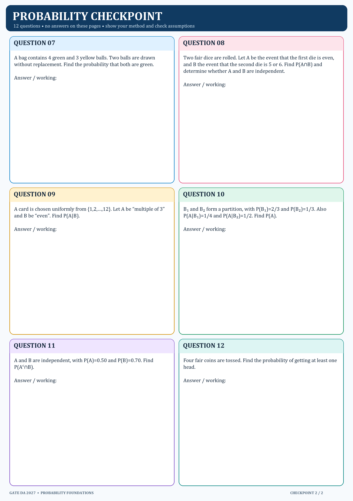

# Probability Foundations checkpoint

**12 questions. No answers are included here.** Show your setup, especially event definitions and conditioning steps.

## Questions

### 1.

A number is chosen uniformly from {1,2,…,10}. Let A be the event that it is even and B the event that it is divisible by 3. Find P(A∪B).

### 2.

For events A and B, P(A)=0.55, P(B)=0.40, and P(A∩B)=0.20. Find P(A∪B) and the probability that neither event occurs.

### 3.

Events A and B are mutually exclusive, with P(A)=0.30 and P(B)=0.20. Find P(A∪B). Are A and B independent? Give the defining check.

### 4.

A and B are independent, with P(A)=0.40 and P(B)=0.25. Find P(A∩B) and P(A|B).

### 5.

P(A)=0.60, P(B|A)=0.50, and P(B|Aᶜ)=0.20. Find P(B).

### 6.

A condition occurs in 2% of people. A test is positive for 95% of people with the condition and for 5% of people without it. Given a positive result, find the probability that the person has the condition.

### 7.

A bag contains 4 green and 3 yellow balls. Two balls are drawn without replacement. Find the probability that both are green.

### 8.

Two fair dice are rolled. Let A be the event that the first die is even, and B the event that the second die is 5 or 6. Find P(A∩B) and determine whether A and B are independent.

### 9.

A card is chosen uniformly from {1,2,…,12}. Let A be “multiple of 3” and B be “even”. Find P(A|B).

### 10.

B₁ and B₂ form a partition, with P(B₁)=2/3 and P(B₂)=1/3. Also P(A|B₁)=1/4 and P(A|B₂)=1/2. Find P(A).

### 11.

A and B are independent, with P(A)=0.50 and P(B)=0.70. Find P(Aᶜ∩B).

### 12.

Four fair coins are tossed. Find the probability of getting at least one head.
