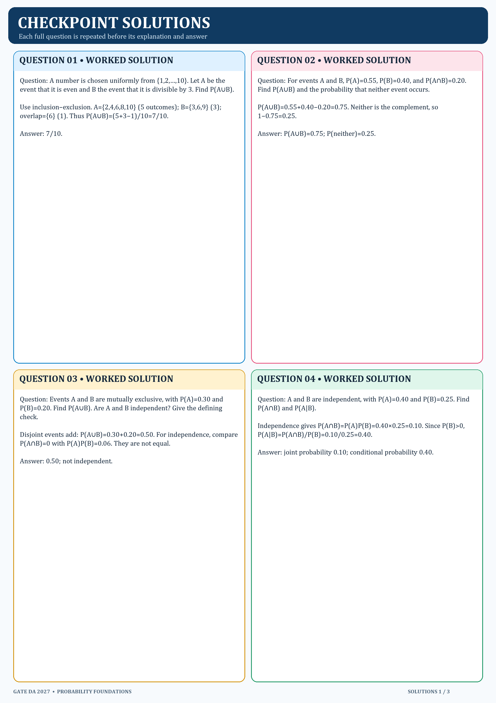
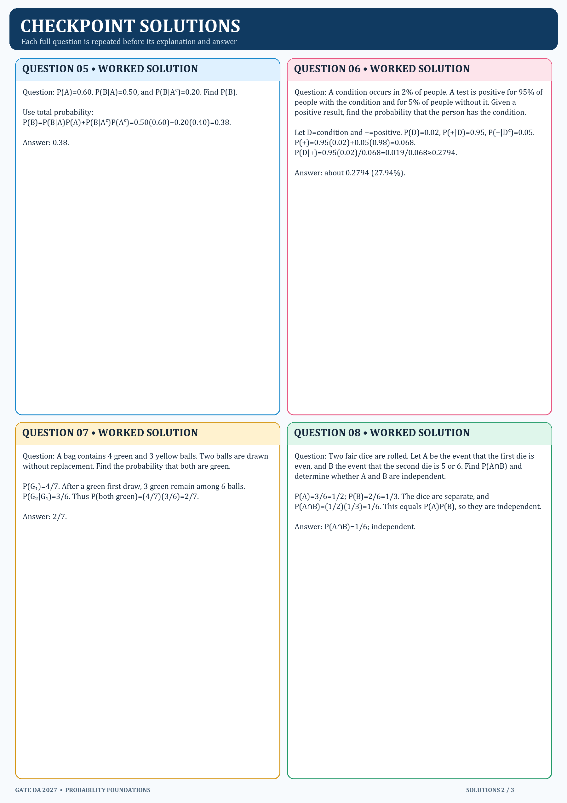
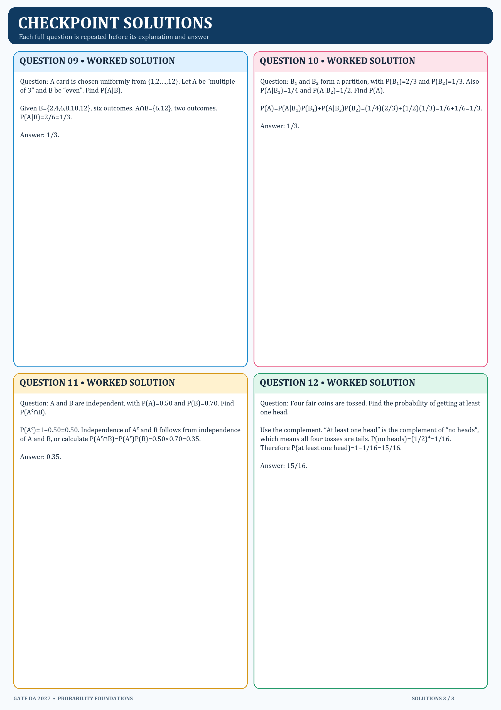

# Probability Foundations checkpoint — worked solutions

This separate sheet repeats each full question before the explanation and answer. Use it after attempting the checkpoint.

## Question 1

A number is chosen uniformly from {1,2,…,10}. Let A be the event that it is even and B the event that it is divisible by 3. Find P(A∪B).

Use inclusion–exclusion. A={2,4,6,8,10} (5 outcomes); B={3,6,9} (3); overlap={6} (1). Thus P(A∪B)=(5+3−1)/10=7/10.

Answer: 7/10.

## Question 2

For events A and B, P(A)=0.55, P(B)=0.40, and P(A∩B)=0.20. Find P(A∪B) and the probability that neither event occurs.

P(A∪B)=0.55+0.40−0.20=0.75. Neither is the complement, so 1−0.75=0.25.

Answer: P(A∪B)=0.75; P(neither)=0.25.

## Question 3

Events A and B are mutually exclusive, with P(A)=0.30 and P(B)=0.20. Find P(A∪B). Are A and B independent? Give the defining check.

Disjoint events add: P(A∪B)=0.30+0.20=0.50. For independence, compare P(A∩B)=0 with P(A)P(B)=0.06. They are not equal.

Answer: 0.50; not independent.

## Question 4

A and B are independent, with P(A)=0.40 and P(B)=0.25. Find P(A∩B) and P(A|B).

Independence gives P(A∩B)=P(A)P(B)=0.40×0.25=0.10. Since P(B)>0, P(A|B)=P(A∩B)/P(B)=0.10/0.25=0.40.

Answer: joint probability 0.10; conditional probability 0.40.

## Question 5

P(A)=0.60, P(B|A)=0.50, and P(B|Aᶜ)=0.20. Find P(B).

Use total probability: P(B)=P(B|A)P(A)+P(B|Aᶜ)P(Aᶜ)=0.50(0.60)+0.20(0.40)=0.38.

Answer: 0.38.

## Question 6

A condition occurs in 2% of people. A test is positive for 95% of people with the condition and for 5% of people without it. Given a positive result, find the probability that the person has the condition.

Let D=condition and +=positive. P(D)=0.02, P(+|D)=0.95, P(+|Dᶜ)=0.05.
P(+)=0.95(0.02)+0.05(0.98)=0.068.
P(D|+)=0.95(0.02)/0.068=0.019/0.068≈0.2794.

Answer: about 0.2794 (27.94%).

## Question 7

A bag contains 4 green and 3 yellow balls. Two balls are drawn without replacement. Find the probability that both are green.

P(G₁)=4/7. After a green first draw, 3 green remain among 6 balls. P(G₂|G₁)=3/6. Thus P(both green)=(4/7)(3/6)=2/7.

Answer: 2/7.

## Question 8

Two fair dice are rolled. Let A be the event that the first die is even, and B the event that the second die is 5 or 6. Find P(A∩B) and determine whether A and B are independent.

P(A)=3/6=1/2; P(B)=2/6=1/3. The dice are separate, and P(A∩B)=(1/2)(1/3)=1/6. This equals P(A)P(B), so they are independent.

Answer: P(A∩B)=1/6; independent.

## Question 9

A card is chosen uniformly from {1,2,…,12}. Let A be “multiple of 3” and B be “even”. Find P(A|B).

Given B={2,4,6,8,10,12}, six outcomes. A∩B={6,12}, two outcomes. P(A|B)=2/6=1/3.

Answer: 1/3.

## Question 10

B₁ and B₂ form a partition, with P(B₁)=2/3 and P(B₂)=1/3. Also P(A|B₁)=1/4 and P(A|B₂)=1/2. Find P(A).

P(A)=P(A|B₁)P(B₁)+P(A|B₂)P(B₂)=(1/4)(2/3)+(1/2)(1/3)=1/6+1/6=1/3.

Answer: 1/3.

## Question 11

A and B are independent, with P(A)=0.50 and P(B)=0.70. Find P(Aᶜ∩B).

P(Aᶜ)=1−0.50=0.50. Independence of Aᶜ and B follows from independence of A and B, or calculate P(Aᶜ∩B)=P(Aᶜ)P(B)=0.50×0.70=0.35.

Answer: 0.35.

## Question 12

Four fair coins are tossed. Find the probability of getting at least one head.

Use the complement. “At least one head” is the complement of “no heads”, which means all four tosses are tails. P(no heads)=(1/2)⁴=1/16. Therefore P(at least one head)=1−1/16=15/16.

Answer: 15/16.

