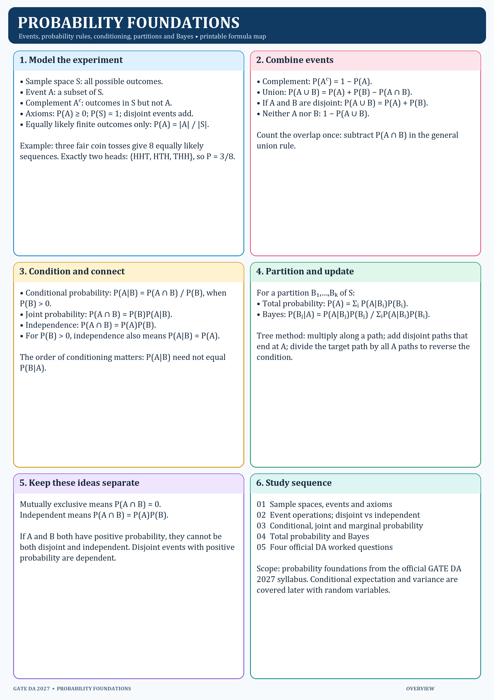
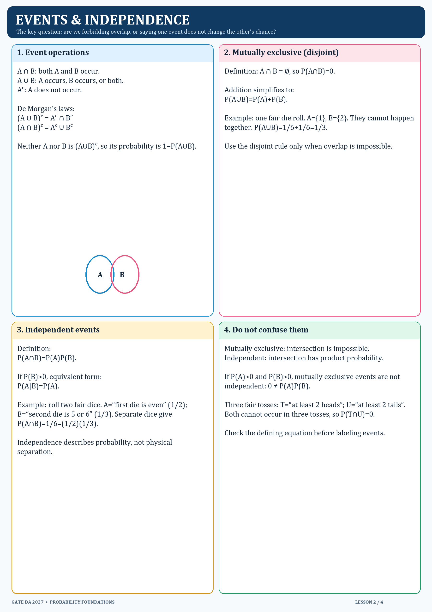
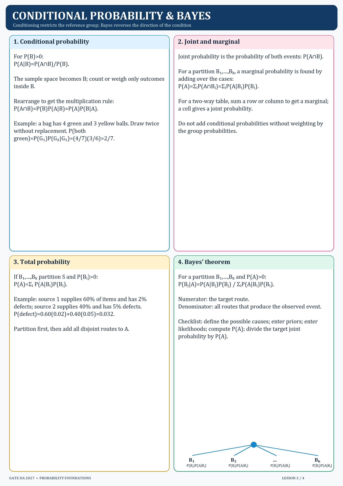
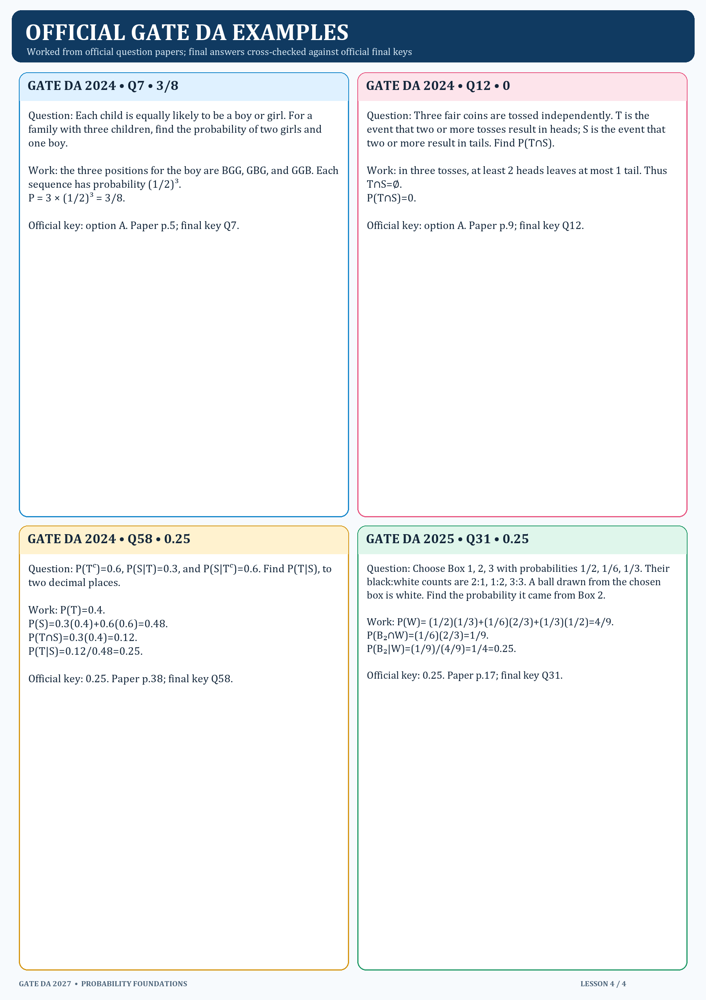

# Probability Foundations — lesson map

| Order | Lesson | PNG |
|---:|---|---|
| 0 | Formula overview | `../PNG/00_Probability_Foundations_Overview.png` |
| 1 | Sample spaces and axioms | `../PNG/01_Sample_Spaces_and_Axioms.png` |
| 2 | Event operations and independence | `../PNG/02_Event_Operations_and_Independence.png` |
| 3 | Conditional, joint, marginal probability and Bayes | `../PNG/03_Conditional_Marginal_and_Bayes.png` |
| 4 | Official DA worked examples | `../PNG/04_Official_DA_Worked_Examples.png` |

The topic starts by defining outcomes and events, then combines events, then conditions on information, and finally reverses a conditional probability with Bayes’ theorem.

