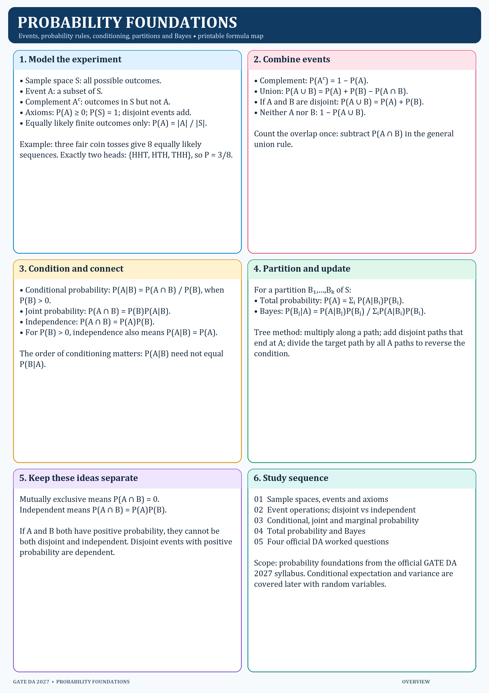

# Probability Foundations

**Scope:** probability axioms, sample spaces, events, independent and mutually exclusive events, joint/marginal/conditional probability, total probability, and Bayes’ theorem. This follows the official GATE DA 2027 syllabus.

## Lesson sequence

1. [Sample spaces and axioms](01_Sample_Spaces_and_Axioms.md)
2. [Event operations and independence](02_Event_Operations_and_Independence.md)
3. [Conditional, joint, marginal probability and Bayes](03_Conditional_Marginal_and_Bayes.md)
4. [Official DA worked examples](04_Official_DA_Worked_Examples.md)
5. [Checkpoint](Checkpoint.md) — 12 questions; answers are omitted.
6. [Separate solutions](Checkpoint_Solutions.md) — repeats every question with its explanation and answer.

## Print order

Print the overview and four lesson pages, then the two checkpoint pages. Keep the three solutions pages separate until after the attempt. PNGs are in `../PNG/`; Markdown sources in this folder are editable.

## Status

Materials are prepared. The checkpoint is **unattempted**; no study hours or focused day are recorded. Probability and Statistics remains at **0/4 reported focused study days**.

## Source trail

- Official scope: `../../../../DA_GATE2027_Syllabus.pdf`, Probability and Statistics section.
- Official question text: GATE DA 2024 Q7 (paper p.5), Q12 (p.9), Q58 (p.38); GATE DA 2025 Q31 (p.17).
- Final answers were checked against the corresponding 2024 and 2025 official final answer keys in `../../../../Resources/Gate DA previous year question papers and answer keys/`.
